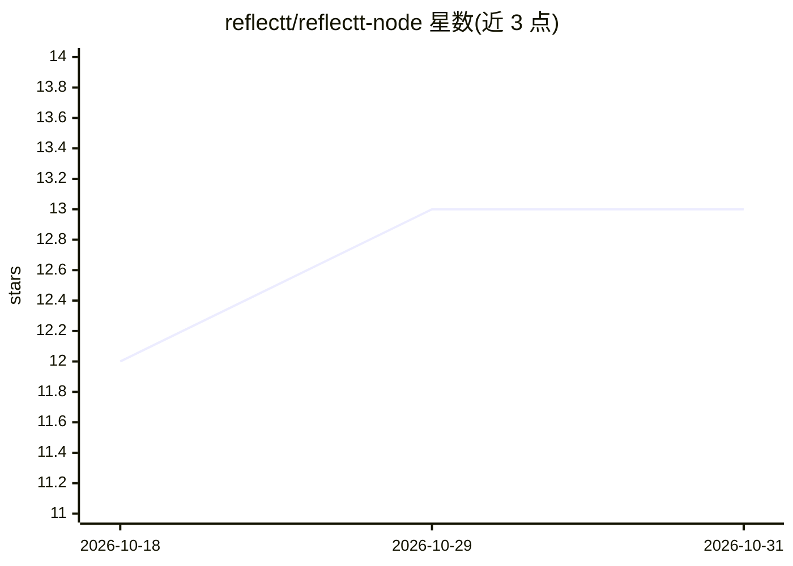

# reflectt/reflectt-node

⭐ 13 · TypeScript · Apache-2.0 · 推送 2026-05-13 · [GitHub](https://github.com/reflectt/reflectt-node) · [官网](https://reflectt.ai) · 组织维护

**自托管的多 AI agent 协调服务器：共享任务、消息与状态**

面向并行运行多个 AI agent 的团队的 Node.js 自托管协调服务器：提供共享任务板（先到先得的任务认领、409 冲突处理）、agent 间收件箱异步消息、presence 心跳、任务后反思记录、实时 dashboard，以及 REST + WebSocket API，任意框架的 agent 经 HTTP 接入。还含 Canvas 富内容推送、agent 状态机与停滞干预机制。通过 npm 全局安装或 Docker 运行，可选连接 app.reflectt.ai 云端同步。

## 筛选速览

| 维度 | 判定 | 备注 |
|---|---|---|
| AI 角色 | `ai-ecosystem` | LLM/agent 周边工具 |
| 许可风险 | `permissive` | Apache-2.0 |
| 部署形态 | `self-host` | docker 或自建部署 |
| 模型依赖 | — | README 未给出锁定关系 |
| 硬件要求 | — | 无带数字的原话,不猜 |
| 安装摩擦 | `low` | 无编译、无系统依赖或容器化 |
| 成熟度 | — | 结构信号不足 |

## 能力要点

- 共享任务板：任务认领先到先得，冲突返回 409
- REST + WebSocket API，任意框架 agent 经 HTTP 接入，/capabilities 自发现
- presence 心跳、agent 间收件箱、反思记录与实时 dashboard
- agent 状态机含停滞检测与干预引擎（escalate/retry/defer/abort）

## 适用场景

- 多个 agent 并行工作时分派任务、避免重复劳动
- 跨 agent 的异步消息传递与工作交接
- 在一个面板查看 agent 团队的任务、活动与健康状态

## 场景标签

`多智能体` · 领域:Agent 开发

## 证据(README 行号)

> L12: reflectt-node is the coordination server your agents talk to - shared task board, presence tracking, reviewer hando
> L83: - **REST + WebSocket API** - any agent in any framework can connect.

## 星数曲线

2026-10-18 12 → 2026-10-31 13（+1）

---
*卡片 v1 · prompt 1.4 · 生成 2026-10-31 · 置信度 high · 依据 README sha `a1d342d69761` · [字段定义](../../DATASET.md)*
