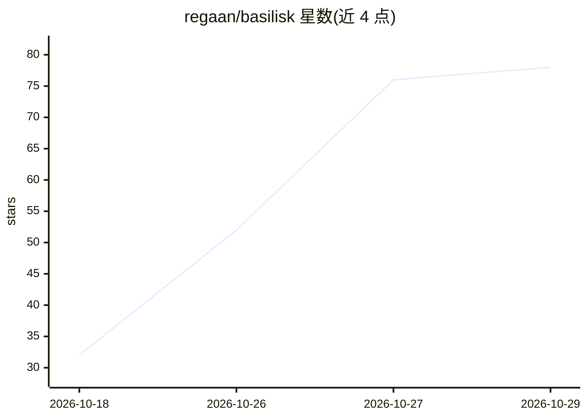

# regaan/basilisk

⭐ 78 · Python · NOASSERTION · 推送 2026-10-01 · [GitHub](https://github.com/regaan/basilisk) · [官网](https://basilisk.rothackers.com) · 个人维护

**AI 红队测试框架：用遗传算法演化对抗提示词评估 LLM 安全性**

面向安全研究员、渗透测试与防御团队的开源 LLM 安全测试框架。通过 SPE-NL 遗传算法引擎（10 种变异算子、5 种交叉策略、多目标适应度、NSGA-II 帕累托排序）对 Claude、Gemini、Grok、GPT 系列及本地运行时与自定义端点自动执行对抗提示测试。提供 33 个攻击模块（对齐 OWASP LLM Top 10）、5 个侦察模块、差分多模型扫描、护栏姿态评分、Ed25519 签名审计日志与 5 种报告格式，含 Electron 桌面端与 GitHub Action CI/CD 集成。AGPL-3.0 许可，附 SSRN 研究论文。

## 筛选速览

| 维度 | 判定 | 备注 |
|---|---|---|
| AI 角色 | `ai-ecosystem` | LLM/agent 周边工具 |
| 许可风险 | `viral` | NOASSERTION |
| 部署形态 | `desktop` | 安装包/桌面程序 |
| 模型依赖 | local-ok | 支持本地模型 |
| 硬件要求 | — | 无带数字的原话,不猜 |
| 安装摩擦 | `low` | 无编译、无系统依赖或容器化 |
| 成熟度 | — | 结构信号不足 |

## 能力要点

- SPE-NL 遗传算法演化对抗提示词（10 变异算子 / 5 交叉策略 / NSGA-II 多目标适应度）
- 33 个攻击模块对齐 OWASP LLM Top 10，含三级信任分级与证据降级机制
- 支持差分多模型扫描与 A+~F 护栏姿态评分
- Ed25519 签名审计日志（SHA-256 链式完整性、API key 自动脱敏）

## 适用场景

- 对 LLM 应用执行可重复的红队安全测试与越狱测试
- 在 CI/CD 流水线中以 SARIF 输出做 AI 安全回归检测
- 横向对比多个模型供应商对相同攻击探针的拒答差异
- 评估模型护栏姿态并生成可导出的安全审计报告

## 场景标签

`网络安全` · 领域:学习与行业

## 证据(README 行号)

> L3: > **Basilisk** is an open-source AI red teaming and LLM security testing framework. It automates adversarial prompt 
> L55: **Basilisk** is an open-source offensive security framework purpose-built for **AI red teaming** and **LLM penetrat
> L67: - **Broad Provider Support**: OpenAI, Anthropic, Google, NVIDIA API Catalog, xAI (Grok), Groq, Azure, AWS Bedrock, 

## 星数曲线

2026-10-18 32 → 2026-10-29 78（+46）

---
*卡片 v1 · prompt 1.4 · 生成 2026-10-25 · 置信度 mid · 依据 README sha `87018bcf77a4` · [字段定义](../../DATASET.md)*
