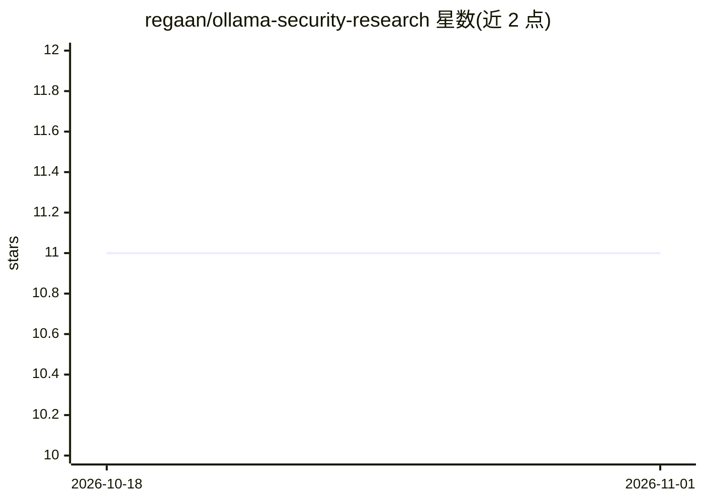

# regaan/ollama-security-research

⭐ 11 · Python · 推送 2026-06-27 · [GitHub](https://github.com/regaan/ollama-security-research) · 个人维护

**Ollama 漏洞安全研究与 PoC 复现材料集**

针对 Ollama 的安全研究仓库，记录两项通过协同披露渠道上报的漏洞：恶意构造的 GGUF 文件中不受信的 64 位字符串长度字段可触发 runtime panic 导致服务终止；模型转换管道接受无上限的 vocab_size 值，可造成 CPU、内存与 swap 耗尽及 OOM。仓库提供各漏洞的技术分析、PoC 演示与复现材料，按漏洞分目录组织，面向研究人员、防御者与开发者，仅限教育、防御与研究用途。

## 筛选速览

| 维度 | 判定 | 备注 |
|---|---|---|
| AI 角色 | `ai-knowledge` | 知识聚合/清单类 |
| 许可风险 | `none` | — |
| 部署形态 | `None` |  |
| 模型依赖 | — | README 未给出锁定关系 |
| 硬件要求 | — | 无带数字的原话,不猜 |
| 安装摩擦 | `low` | 无编译、无系统依赖或容器化 |
| 成熟度 | — | 结构信号不足 |

## 能力要点

- GGUF 字符串长度字段 panic 导致远程拒绝服务
- 无上限 vocab_size 引发资源耗尽（CPU/内存/OOM）
- 含 PoC 演示与复现材料，按漏洞分目录组织

## 适用场景

- 安全研究人员复现 Ollama 的 DoS 漏洞
- 防御者了解不可信模型数据的攻击面与影响
- 开发者参考漏洞根因做边界校验加固

## 场景标签

`网络安全` · 领域:学习与行业

## 证据(README 行号)

> L3: This repository contains technical analysis, proof-of-concept demonstrations, and reproduction material for multiple
> L5: The findings documented here focus on denial-of-service conditions caused by improper handling of untrusted model da
> L78: The repository serves as a technical reference for researchers, defenders, and developers interested in understandi

## 星数曲线

2026-10-18 11 → 2026-11-01 11（+0）

---
*卡片 v1 · prompt 1.4 · 生成 2026-11-01 · 置信度 high · 依据 README sha `a0842b67d132` · [字段定义](../../DATASET.md)*
