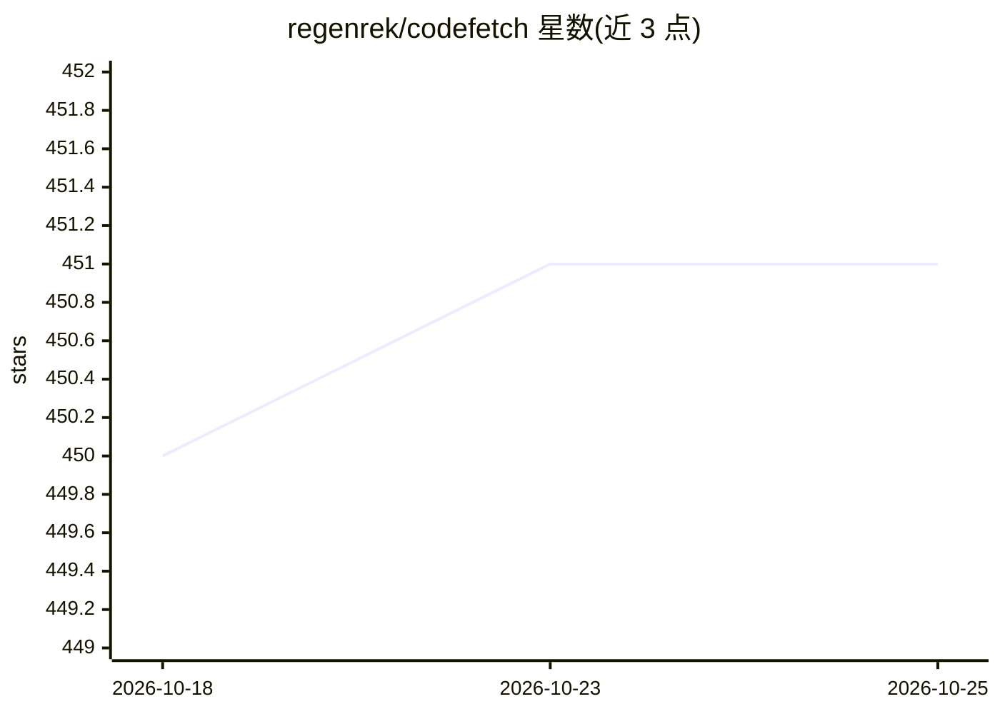

# regenrek/codefetch

⭐ 451 · TypeScript · MIT · 推送 2025-12-07 · [GitHub](https://github.com/regenrek/codefetch) · 个人维护

**把代码仓库转成 LLM 友好 Markdown 的 CLI 工具**

面向开发者的 npm 命令行工具：将本地代码库或 git 仓库（GitHub API 优先、git clone 回退，支持 GitHub/GitLab/Bitbucket 及网页爬取）转换为带语义 XML 标签（task/filetree/source_code）的结构化 Markdown 文件，遵循 .gitignore 与 .codefetchignore 过滤，提供 GPT-4/GPT-3/Claude 等多种 token 计数编码器与 max-tokens 限额策略（sequential/truncated）。支持附加提示词、open 子命令复制到剪贴板并打开 ChatGPT/Gemini/Claude 网页。限制：本体不调用模型，仅生成上下文文本。

## 筛选速览

| 维度 | 判定 | 备注 |
|---|---|---|
| AI 角色 | `ai-ecosystem` | LLM/agent 周边工具 |
| 许可风险 | `permissive` | MIT |
| 部署形态 | `library` | 以包/库形式分发 |
| 模型依赖 | — | README 未给出锁定关系 |
| 硬件要求 | — | 无带数字的原话,不猜 |
| 安装摩擦 | `low` | 无编译、无系统依赖或容器化 |
| 成熟度 | — | 结构信号不足 |

## 能力要点

- 本地代码库与 git 仓库（GitHub API/git clone/网页爬取）转 Markdown
- 语义 XML 标签输出结构与项目树可视化
- 多编码器 token 计数与 sequential/truncated 限额策略
- open 子命令复制到剪贴板并打开 ChatGPT/Gemini/Claude

## 适用场景

- 把整个代码库打包喂给 ChatGPT/Gemini/Claude 做代码审查或问答
- 统计代码库 token 数以估算模型上下文占用
- 生成遵守忽略规则的项目结构树文档

## 场景标签

 · 领域:开发者工具/LLM 基础设施

## 证据(README 行号)

> L7: > Turn code repositories into AI-friendly Markdown documentation
> L9: Codefetch is a powerful tool that converts git repositories and local codebases into structured Markdown files optim
> L342: ## Use with GPT, Gemini, Claude, and Other AI Models

## 星数曲线

2026-10-18 450 → 2026-10-25 451（+1）

---
*卡片 v1 · prompt 1.4 · 生成 2026-10-23 · 置信度 high · 依据 README sha `2a368a070f48` · [字段定义](../../DATASET.md)*
