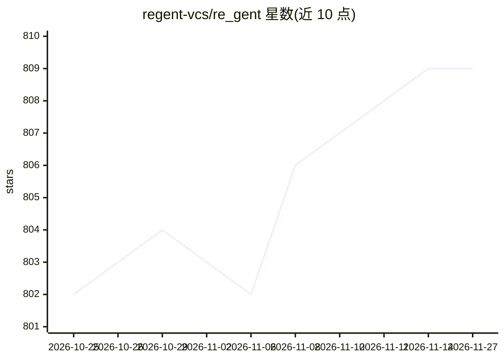

# regent-vcs/re_gent

⭐ 809 · Go · Apache-2.0 · 推送 2026-11-11 · [GitHub](https://github.com/regent-vcs/re_gent) · 组织维护

**给 AI 编码代理做版本控制：记录每步操作并溯源到提示词**

以 CLI（rgt）形式运行的 AI 代理活动版本控制系统：代理每次工具调用自动生成内容寻址的 Step 快照（含变更、原因与请求者），按会话组成 DAG 存储，无需手动提交。提供 log/blame/show/sessions 等命令，可将任意代码行溯源到产生它的提示词，并保留 /compact 与 /clear 之后的对话记录。通过 hook 在 rgt init 时自动接入 Claude Code、Codex CLI 与 OpenCode；README 明确其定位是补充而非替代 git。安装支持 Homebrew、go install、源码构建与预编译二进制。

## 筛选速览

| 维度 | 判定 | 备注 |
|---|---|---|
| AI 角色 | `ai-ecosystem` | LLM/agent 周边工具 |
| 许可风险 | `permissive` | Apache-2.0 |
| 部署形态 | `library` | 以包/库形式分发 |
| 模型依赖 | — | README 未给出锁定关系 |
| 硬件要求 | — | 无带数字的原话,不猜 |
| 安装摩擦 | `low` | 无编译、无系统依赖或容器化 |
| 成熟度 | — | 结构信号不足 |

## 能力要点

- 每次代理工具调用自动生成内容寻址 Step（BLAKE3），按会话组成 DAG
- rgt blame 可将代码行溯源到产生它的提示词
- SQLite 索引与 /compact、/clear 后仍保留的对话追踪
- VSCode 扩展提供行内 blame 注释与会话时间线

## 适用场景

- 追踪代理重构后代码回归的原因与来源
- 审计代理会话中每一步文件变更的上下文
- 同时管理多个并发代理会话的变更记录

## 场景标签

`编码 Agent` · 领域:编码与开发

## 证据(README 行号)

> L9:  Version Control for AI Agents
> L11:  Track what your agent did, which prompt wrote each line, and inspect any step.
> L168: |**Claude Code**|Fully supported|

## 星数曲线

2026-10-25 802 → 2026-11-27 809（+7）

---
*卡片 v1 · prompt 1.4 · 生成 2026-11-25 · 置信度 high · 依据 README sha `4c1676e21538` · [字段定义](../../DATASET.md)*
