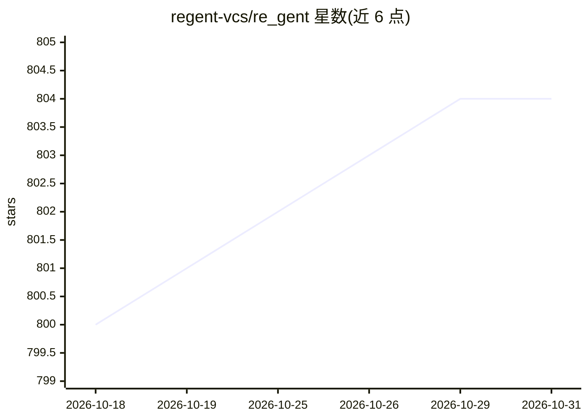

# regent-vcs/re_gent

⭐ 804 · Go · Apache-2.0 · 推送 2026-07-02 · [GitHub](https://github.com/regent-vcs/re_gent) · 组织维护

**给 AI 编程 agent 用户的版本控制工具：审计与溯源 agent 操作**

用 Go 编写的命令行工具，为 AI 编程 agent（Claude Code、OpenAI Codex CLI、OpenCode）提供版本控制与审计：每个工具调用轮次生成内容寻址的 Step 快照，存于 .regent/ 目录（BLAKE3 哈希对象、SQLite 查询索引、按会话分支的 DAG）。提供 rgt log/blame/show 等命令，可将任意代码行归因到具体 prompt，追踪多并发会话。通过 Homebrew、go install、源码编译或二进制发布安装，另有 VSCode 扩展提供行内 blame 注解。声明与 git 互补而非替代。

## 筛选速览

| 维度 | 判定 | 备注 |
|---|---|---|
| AI 角色 | `ai-ecosystem` | LLM/agent 周边工具 |
| 许可风险 | `permissive` | Apache-2.0 |
| 部署形态 | `library` | 以包/库形式分发 |
| 模型依赖 | — | README 未给出锁定关系 |
| 硬件要求 | — | 无带数字的原话,不猜 |
| 安装摩擦 | `low` | 无编译、无系统依赖或容器化 |
| 成熟度 | — | 结构信号不足 |

## 能力要点

- rgt blame 将代码行归因到具体 prompt
- 内容寻址存储（BLAKE3）+ SQLite 索引，亚 10ms 查询
- 按会话分支的 DAG，支持并发会话追踪
- Claude Code / Codex CLI / OpenCode 钩子自动配置

## 适用场景

- 排查 AI agent 改动导致的回归问题
- 查看某行代码由哪个 prompt 生成
- 同时运行多个 agent 会话时追踪各自改动

## 场景标签

`LLM 可观测性` · 领域:评测与运维

## 证据(README 行号)

> L9:  Version Control for AI Agents
> L11:  Track what your agent did, which prompt wrote each line, and inspect any step.
> L164: ## Supported Tools

## 星数曲线

2026-10-18 800 → 2026-10-31 804（+4）

---
*卡片 v1 · prompt 1.4 · 生成 2026-10-21 · 置信度 high · 依据 README sha `355b00403060` · [字段定义](../../DATASET.md)*
