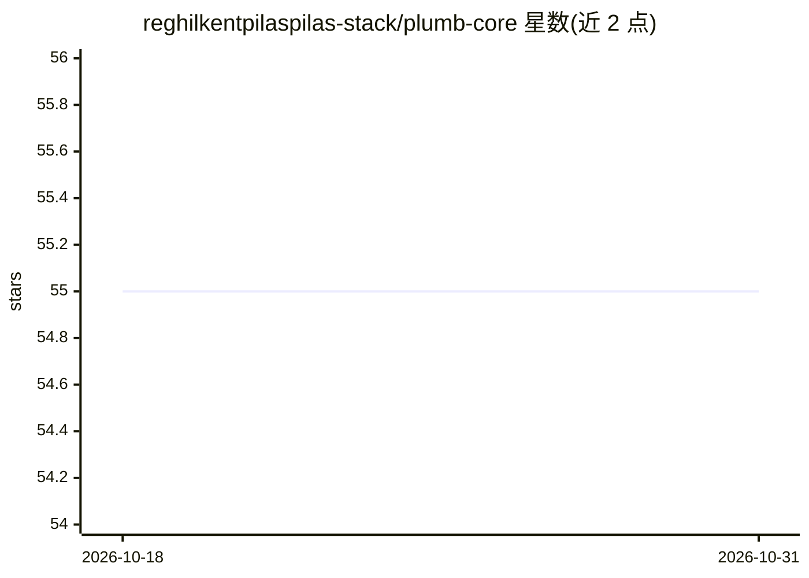

# reghilkentpilaspilas-stack/plumb-core

⭐ 55 · HTML · 推送 2026-10-21 · [GitHub](https://github.com/reghilkentpilaspilas-stack/plumb-core) · 组织维护

**嵌入式 Linux 上的模块化 AI 技能编排框架**

面向嵌入式 Linux 工程师的技能编排框架：将重复的硬件诊断、配置与优化脚本转化为自适应技能，由事件驱动的调度器根据系统负载、温度与电池状态在技能间切换。技能可用 C/Lua/Python/Shell 编写并编译为 skill.tide 清单（含内核模块、WCET 等元数据）；通过 YAML 声明式编排语言组合工作流，用 eBPF 钩子在内核层执行 cgroup 资源预算。含技能签名（ed25519）、看门狗、回滚与离线模拟器。以单个静态 Arm64 二进制 + YAML 配置目录交付，需 Linux 5.15+ 内核与约 2MB flash。

## 筛选速览

| 维度 | 判定 | 备注 |
|---|---|---|
| AI 角色 | `ai-ecosystem` | LLM/agent 周边工具 |
| 许可风险 | `none` | — |
| 部署形态 | `None` |  |
| 模型依赖 | — | README 未给出锁定关系 |
| 硬件要求 | — | 无带数字的原话,不猜 |
| 安装摩擦 | `low` | 无编译、无系统依赖或容器化 |
| 成熟度 | — | 结构信号不足 |

## 能力要点

- 技能生命周期五阶段调度，按负载/温度/电池状态自动升降级
- 技能自描述并在启动/热插拔时注册，通过内省协议发布能力
- eBPF + cgroup 在内核层强制执行每技能的 CPU/内存/IO 预算
- ed25519 技能签名、看门狗熔断、确定性回滚与 tide-sim 离线模拟

## 适用场景

- 把 I2C 探测、flash 校验等重复硬件脚本转为可复用技能
- 多 SoC 板级调试与汽车 IoT/工业控制器的诊断自动化
- 在温度越限时自动切换轻量技能保持业务连续性

## 场景标签

`Agent 框架` · 领域:Agent 开发

## 证据(README 行号)

> L6: **TideLink** is a modular, event-driven AI skill framework designed for the embedded Linux ecosystem. While the orig
> L38: Skills can be authored in C, Lua, Python (MicroPython for constrained devices), or even pure shell — without any ru

## 星数曲线

2026-10-18 55 → 2026-10-31 55（+0）

---
*卡片 v1 · prompt 1.4 · 生成 2026-10-24 · 置信度 mid · 依据 README sha `4d81c9bbc906` · [字段定义](../../DATASET.md)*
