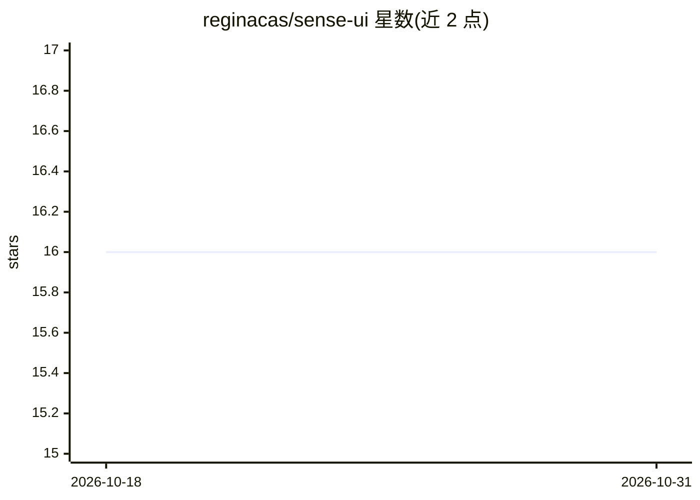

# reginacas/sense-ui

⭐ 16 · JavaScript · MIT · 推送 2026-10-04 · [GitHub](https://github.com/reginacas/sense-ui) · [官网](https://chromewebstore.google.com/detail/senseui/nolkkggkcmpjejlobeljmffhcmbaeflk?hl=en) · 个人维护

**面向盲人与低视力开发者的 AI 网页设计反馈浏览器扩展**

开源 Chromium 浏览器扩展，为盲人和低视力 Web 开发者提供网页设计的实时对话式反馈：生成页面视觉描述、识别设计问题（对齐、可读性、对比度）、给出具体可执行的设计建议。交互为无障碍聊天界面，支持键盘快捷键、斜杠快速命令、反馈详略度三档设置（Comprehensive/Balanced/Concise）、会话下载与持久化。已上架 Chrome Web Store，安装细节指向 Setup Guide。项目为 maintainer 的人机交互硕士论文的一部分，声明毕业后仓库保持开源。

## 筛选速览

| 维度 | 判定 | 备注 |
|---|---|---|
| AI 角色 | `ai-native` | 本体是模型或模型工具 |
| 许可风险 | `permissive` | MIT |
| 部署形态 | `None` |  |
| 模型依赖 | — | README 未给出锁定关系 |
| 硬件要求 | — | 无带数字的原话,不猜 |
| 安装摩擦 | `low` | 无编译、无系统依赖或容器化 |
| 成熟度 | `idea` | |

## 能力要点

- 对话式界面生成页面视觉描述与设计问题识别
- 三档反馈详略度设置与会话下载
- 键盘快捷键（如 Ctrl+Shift+S）与屏幕阅读器友好界面
- 已上架 Chrome Web Store

## 适用场景

- 不依赖明眼同事即可获得网页设计的视觉描述
- 识别页面对齐、可读性、对比度等设计问题
- 按自己的学习需求调整反馈详略度并下载会话与团队共享

## 场景标签

`聊天机器人` `AI 助手` · 领域:对话与助手

## 证据(README 行号)

> L5: SenseUI is an open-source Chromium extension that gives blind and low-vision web developers real-time, actionable fe
> L96: SenseUI is a chat interface. You ask it questions about your webpage and it responds with feedback.

## 星数曲线

2026-10-18 16 → 2026-10-31 16（+0）

---
*卡片 v1 · prompt 1.4 · 生成 2026-10-30 · 置信度 high · 依据 README sha `693e149dc9a2` · [字段定义](../../DATASET.md)*
