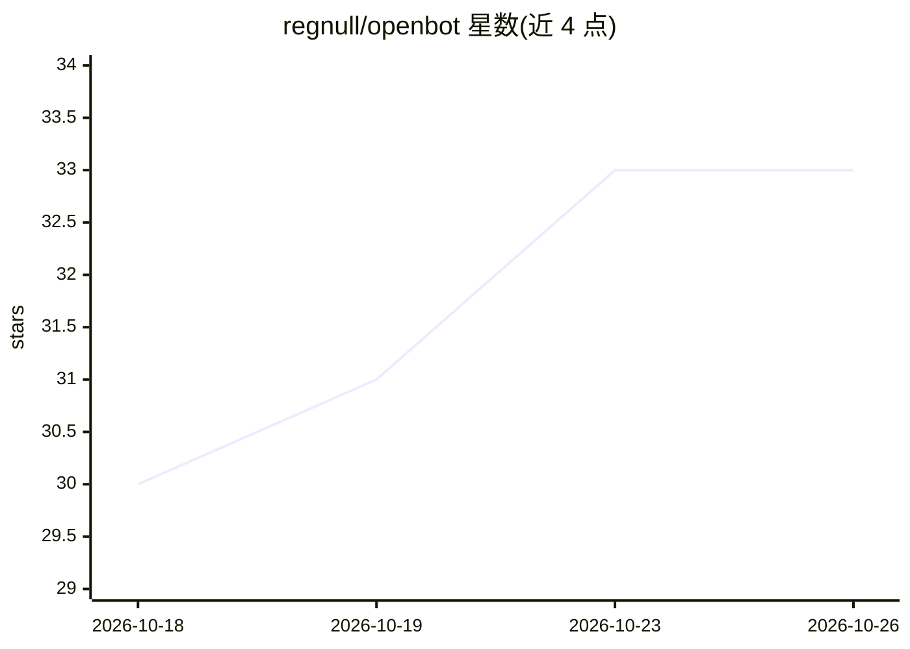

# regnull/openbot

⭐ 33 · Python · MIT · 推送 2026-10-23 · [GitHub](https://github.com/regnull/openbot) · 个人维护

**自托管多 AI bot 团队运行平台：持久记忆、工具与相互协作**

开源、可自托管的多机器人运行平台：以 actor 模型统一 bot、人类与外部系统，每个 actor 拥有持久收件箱；bot 收到消息即运行带工具与长期记忆的 LLM agent 循环，通过 @mention 相互移交工作，形成 Chief of Staff→Engineer→Reviewer→QA 等工作流。内置 shell/文件/HTTP 工具、MCP 服务器工具、人工审批与 LangSmith 追踪，提供 React Web UI 与 Electron 桌面应用（macOS/Linux 有安装包，Windows 从源码运行）。限制：run_shell 未沙箱化，需自备 LLM 提供商。

## 筛选速览

| 维度 | 判定 | 备注 |
|---|---|---|
| AI 角色 | `ai-native` | 本体是模型或模型工具 |
| 许可风险 | `permissive` | MIT |
| 部署形态 | `desktop` | 安装包/桌面程序 |
| 模型依赖 | local-ok | 支持本地模型 |
| 硬件要求 | — | 无带数字的原话,不猜 |
| 安装摩擦 | `low` | 无编译、无系统依赖或容器化 |
| 成熟度 | — | 结构信号不足 |

## 能力要点

- actor 模型统一 bot、人类与外部系统（签名 webhook / REST）
- bot 间 @mention 移交形成多机器人工作流，带跳数限制防循环
- 每 bot 长期记忆（LangMem）与后台反思
- 支持任意 MCP 服务器工具（远程/stdio/OAuth）与人工审批

## 适用场景

- 搭建多 bot 协作团队自动完成开发类工作流
- 让 bot 通过 MCP 工具接入外部系统
- 自托管运行带记忆与审批机制的 AI 助手

## 场景标签

`Agent 框架` `多智能体` `Agent 记忆` · 领域:Agent 开发

## 证据(README 行号)

> L18: OpenBot is an open-source, self-hosted platform for running a team of persistent AI bots. Each
> L20: to each other in shared threads, use pluggable tools, keep long-term memory, and can be reached by
> L21: external systems over HTTP. Chains of bots form workflows: for example, a Chief of Staff bot

## 星数曲线

2026-10-18 30 → 2026-10-26 33（+3）

---
*卡片 v1 · prompt 1.4 · 生成 2026-10-25 · 置信度 mid · 依据 README sha `88d75c6166a2` · [字段定义](../../DATASET.md)*
