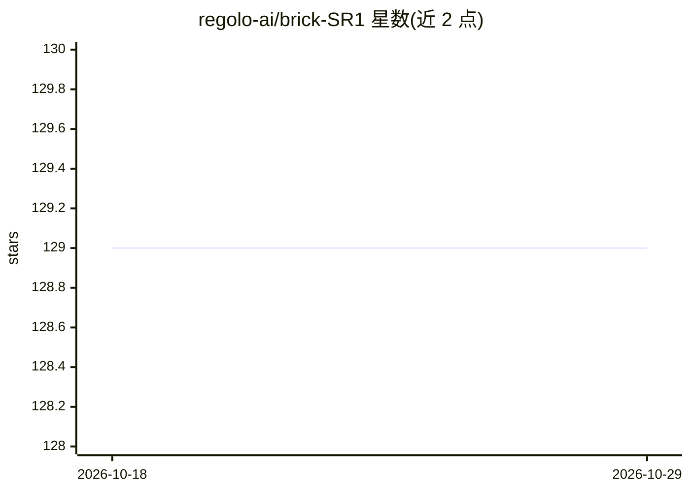

# regolo-ai/brick-SR1

⭐ 129 · Python · Apache-2.0 · 推送 2026-10-28 · [GitHub](https://github.com/regolo-ai/brick-SR1) · [官网](https://regolo.ai) · 组织维护

**LLM 智能路由网关：按提示能力与复杂度分发到模型池**

Brick 是 Mixture-of-Models 路由网关：读取每条提示在编码、数学推理、规划等 6 个能力维度与复杂度信号，将其路由到开放/闭源模型池中最合适的后端，每次查询只做一次前向决策，不使用级联调用。对外暴露单一 OpenAI 兼容端点，`model: "brick"` 即可接入。面向使用多个模型或希望降低 Claude Code / Codex 成本的开发者：提供 CLI（自动接线 Claude Code）、Docker 镜像、5 档成本/质量模式、缓存感知路由与状态面板。限制：快速路径需 Node 20/22+ 与 Docker，官方 claude/codex profile 需先编辑选定模型才能启动。

## 筛选速览

| 维度 | 判定 | 备注 |
|---|---|---|
| AI 角色 | `ai-ecosystem` | LLM/agent 周边工具 |
| 许可风险 | `permissive` | Apache-2.0 |
| 部署形态 | `self-host` | docker 或自建部署 |
| 模型依赖 | local-ok | 支持本地模型 |
| 硬件要求 | — | 无带数字的原话,不猜 |
| 安装摩擦 | `low` | 无编译、无系统依赖或容器化 |
| 成熟度 | — | 结构信号不足 |

## 能力要点

- 按 6 能力维度+复杂度做单次前向路由决策，无级联浪费
- OpenAI 兼容单端点，`model: "brick"` 即用，`x-selected-model` 头显示所选后端
- Claude Code 接线：5 档成本/质量模式，thinking effort 滑块直接切换模型档位
- 缓存感知路由（off/sticky/smartsqueeze）与 JSON 机器可读状态面板

## 适用场景

- 我维护一个多模型池，想让每条请求自动分到合适的模型
- 我在用 Claude Code / Codex，想按任务难度付费以降低成本
- 我想把多家模型统一到一个 OpenAI 兼容端点后面

## 场景标签

`模型网关` · 领域:Agent 开发

## 证据(README 行号)

> L5: Brick is a **Mixture-of-Models (MoM) routing gateway**. It reads each prompt's
> L43:  Code or Codex through a single OpenAI-compatible endpoint. Define the pool

## 星数曲线

2026-10-18 129 → 2026-10-29 129（+0）

---
*卡片 v1 · prompt 1.4 · 生成 2026-10-23 · 置信度 high · 依据 README sha `aa6045c14dba` · [字段定义](../../DATASET.md)*
