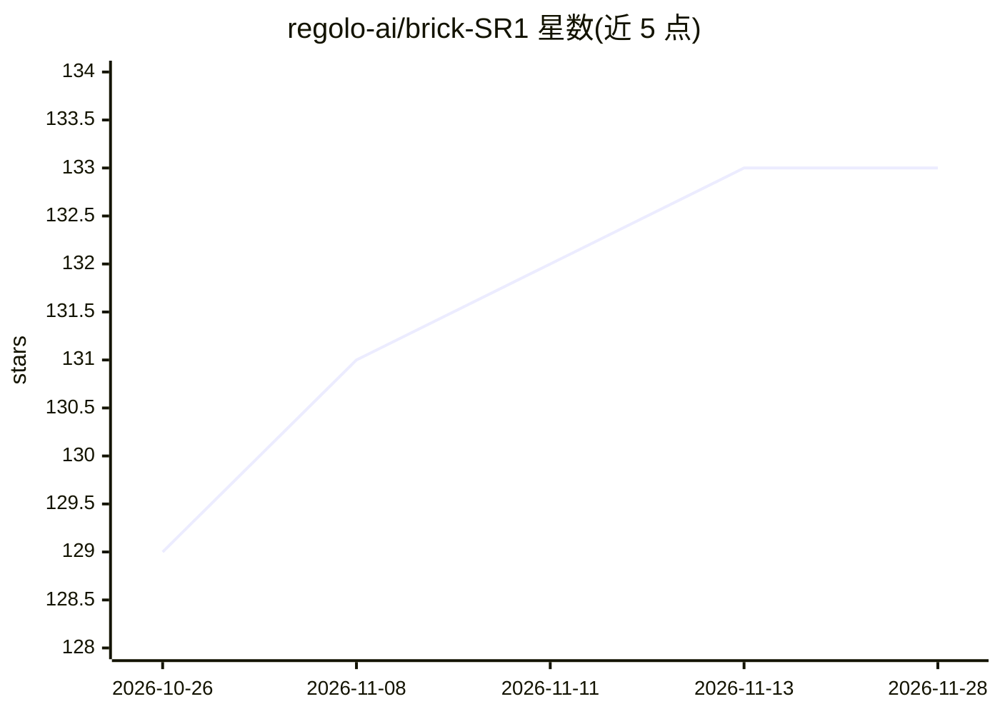

# regolo-ai/brick-SR1

⭐ 133 · Python · Apache-2.0 · 推送 2026-11-27 · [GitHub](https://github.com/regolo-ai/brick-SR1) · [官网](https://regolo.ai) · 组织维护

**面向开发者的 LLM 路由网关：按查询能力向量选模型**

Brick 是一个本地运行的 AI 模型路由器：对用户查询提取六维能力向量（指令遵循、编码、数学推理、世界知识、规划、创意），通过欧氏距离从配置的模型池中选出最匹配的模型。提供 OpenAI Chat Completions、Anthropic Messages 和原生 Responses 三种协议网关，支持流式、认证、工具与多模态传输。SystemOne 推理基于 PyTorch 与 Hugging Face Transformers，由常驻 Python worker 承载，Go 网关通过管道与其通信。模型池、路由旋钮、凭据等以 profile 配置管理，并内置诊断、统计、成本核算与指标端点。

## 筛选速览

| 维度 | 判定 | 备注 |
|---|---|---|
| AI 角色 | `ai-ecosystem` | LLM/agent 周边工具 |
| 许可风险 | `permissive` | Apache-2.0 |
| 部署形态 | `library` | 以包/库形式分发 |
| 模型依赖 | — | README 未给出锁定关系 |
| 硬件要求 | — | 无带数字的原话,不猜 |
| 安装摩擦 | `high` | 编译与系统依赖俱全 |
| 成熟度 | — | 结构信号不足 |

## 能力要点

- 基于本地六维能力向量与欧氏距离的确定性路由
- 提供 OpenAI / Anthropic / 原生 Responses 三种协议网关，支持流式与工具
- effort 覆盖与 X-Brick-Knob 头可直接控制路由旋钮
- 内置诊断、用量统计、成本核算与 /metrics 端点

## 适用场景

- 将 Codex/Claude 客户端接入本地路由器，按查询复杂度分配模型池
- 对多模型部署做按请求的路由与成本核算
- 在无网络环境下用缓存技能表离线运行路由

## 场景标签

`模型网关` · 领域:Agent 开发

## 证据(README 行号)

> L21: Brick routes a query to a model using a local six-dimensional SystemOne capability
> L22: vector. It provides OpenAI Chat Completions, Anthropic Messages, and native
> L132: wires the official Codex client to it. The default pool is `gpt-6.1-terra` and

## 星数曲线

2026-10-26 129 → 2026-11-28 133（+4）

---
*卡片 v1 · prompt 1.4 · 生成 2026-11-28 · 置信度 high · 依据 README sha `be4685e9eb8b` · [字段定义](../../DATASET.md)*
