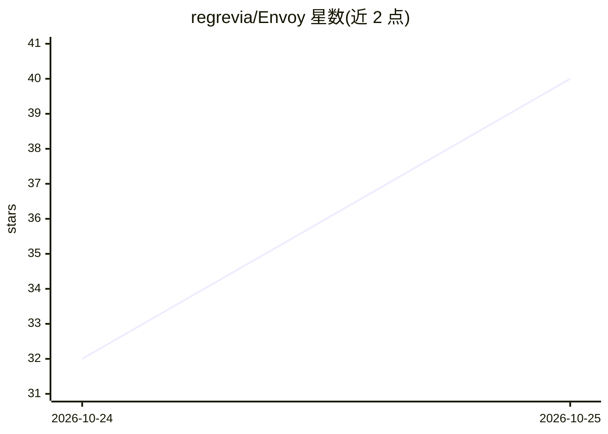

# regrevia/Envoy

⭐ — · [GitHub]() · 个人维护 · 中文 README

**把链接变成带来源定位材料的 Agent Skill + MCP 工具**

面向 AI agent 的内容提取服务：接收网页、公众号、PDF、小红书图文、B 站与本地视频链接，返回切分好、附 video_time 或来源坐标的片段，并提供 envoy_search / envoy_expand 按需续读；视频优先读公开字幕，无字幕时对指定时间段运行本地 Whisper 转写。以 Agent Skill + MCP server 形式接入，Claude Code、Codex、DeepSeek Harness 各有插件，浏览器后台运行、遇登录需接管。不绕过登录、验证码与 DRM；评测处 pilot 阶段（6 来源 12 任务），未宣称效果结论。

## 筛选速览

| 维度 | 判定 | 备注 |
|---|---|---|
| AI 角色 | `ai-ecosystem` | LLM/agent 周边工具 |
| 许可风险 | `permissive` | — |
| 部署形态 | `None` |  |
| 模型依赖 | locked-api |  |
| 硬件要求 | — | 无带数字的原话,不猜 |
| 安装摩擦 | `low` | 无编译、无系统依赖或容器化 |
| 成熟度 | `idea` | |

## 能力要点

- 网页/PDF/图文/视频统一提取为带来源坐标的片段
- 无字幕视频按时间段运行本地 Whisper 并返回 [mm:ss] 转写
- envoy_search / envoy_expand 定位与续读，避免整页重拉
- 未读取的部分标记为未覆盖而非写成结论

## 适用场景

- 让 AI 把长视频整理成带时间戳的知识库条目
- 从公众号文章、小红书图文、PDF 提取可引用的材料
- 在 Claude Code / Codex / DeepSeek Harness 中通过链接获取有出处的素材

## 场景标签

`网页抓取` `文档解析` `语音识别` · 领域:效率与自动化

## 证据(README 行号)

> L49: 浏览器在后台运行，遇到登录或验证才请你接管。接入方式是 Agent Skill + MCP，Claude Code、Codex、DeepSeek Harness 各有插件（Codex 0.156 起需执行一次 `envoy hoo
> L115: The browser runs headlessly and asks you to take over only for login or verification. Access is an Agent Skill plu

## 星数曲线

2026-10-24 32 → 2026-10-25 40（+8）

---
*卡片 v1 · prompt 1.4 · 生成 2026-10-25 · 置信度 high · 依据 README sha `bf74358ad2ea` · [字段定义](../../DATASET.md)*
