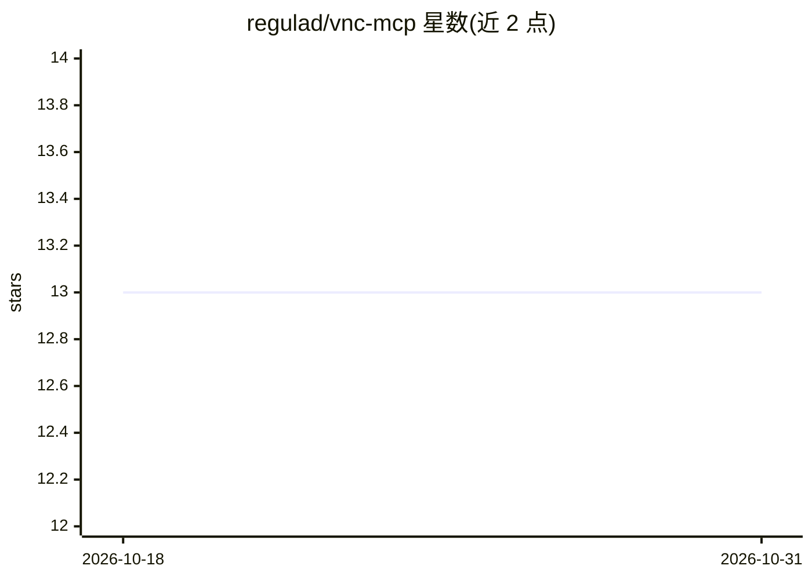

# regulad/vnc-mcp

⭐ 13 · Python · AGPL-3.0 · 推送 2026-03-26 · [GitHub](https://github.com/regulad/vnc-mcp) · [官网](https://vnc-mcp.readthedocs.io/) · 个人维护

**让 MCP 兼容 LLM 通过 VNC 操作任意远程桌面的服务器**

Python 实现的 MCP 服务器：通过 pyvnc 连接符合 RFC6143 RFB 规范的 VNC 服务器，向 LLM 暴露一组 MCP 工具以操作远程桌面，并提供 OCR 屏幕读取与文本提取以适配非多模态模型。要求 VNC 服务器支持规范认证（不支持 Apple ARD）；推荐在 Docker 容器中运行（需 Python 3.12），并以 mcphost/Claude Desktop 格式给出 MCP 客户端接入配置。README 记录了多个发行版与 VNC 服务器组合的测试结果。

## 筛选速览

| 维度 | 判定 | 备注 |
|---|---|---|
| AI 角色 | `ai-ecosystem` | LLM/agent 周边工具 |
| 许可风险 | `viral` | AGPL-3.0 |
| 部署形态 | `None` |  |
| 模型依赖 | — | README 未给出锁定关系 |
| 硬件要求 | — | 无带数字的原话,不猜 |
| 安装摩擦 | `low` | 无编译、无系统依赖或容器化 |
| 成熟度 | — | 结构信号不足 |

## 能力要点

- 连接任意 RFC6143 RFB 规范兼容的 VNC 服务器（pyvnc）
- 暴露 MCP 工具供 LLM 操作远程桌面
- OCR 屏幕读取与文本提取，适配非多模态 LLM
- 以 Docker 容器方式运行并接入 MCP 客户端

## 适用场景

- 让 Claude 等 MCP 客户端模型直接操作我的远程桌面
- 在隔离 VM 中让 LLM 执行桌面自动化任务
- 为非多模态模型提供 OCR 方式的屏幕读取

## 场景标签

`GUI 自动化` · 领域:效率与自动化

## 证据(README 行号)

> L6: 🤖🖥 vnc-mcp allows MCP-compatible LLMs to interact with any desktop accessible over VNC
> L15: - Exposes a number of MCP tools that an LLM can use to interact with a computer through the VNC client.

## 星数曲线

2026-10-18 13 → 2026-10-31 13（+0）

---
*卡片 v1 · prompt 1.4 · 生成 2026-10-31 · 置信度 high · 依据 README sha `3c3d0a031cc2` · [字段定义](../../DATASET.md)*
