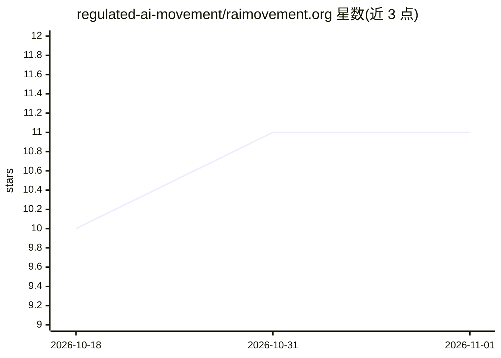

# regulated-ai-movement/raimovement.org

⭐ 11 · TypeScript · MIT · 推送 2026-02-23 · [GitHub](https://github.com/regulated-ai-movement/raimovement.org) · [官网](https://raimovement.org) · 组织维护

**Regulated AI Movement 官网：Next.js 静态站，Notion 作 CMS**

raimovement.org 网站的代码库与静态内容仓库，基于 Next.js 与 nextjs-notion-starter-kit 构建，站点内容静态生成，并以 Notion 作为内容管理系统。面向希望了解或参与 Regulated AI Movement 的访问者与贡献者；仓库接受代码贡献，要求遵循 TypeScript/Next.js/React/Nextra 等技术约定、编写文档与测试。本地开发通过 pnpm install 与 pnpm run dev 启动，开发讨论在 Discord 进行。

## 筛选速览

| 维度 | 判定 | 备注 |
|---|---|---|
| AI 角色 | `ai-knowledge` | 知识聚合/清单类 |
| 许可风险 | `permissive` | MIT |
| 部署形态 | `library` | 以包/库形式分发 |
| 模型依赖 | — | README 未给出锁定关系 |
| 硬件要求 | — | 无带数字的原话,不猜 |
| 安装摩擦 | `low` | 无编译、无系统依赖或容器化 |
| 成熟度 | — | 结构信号不足 |

## 能力要点

- 基于 Next.js 与 nextjs-notion-starter-kit 构建
- 内容静态生成，Notion 作为 CMS
- pnpm 驱动的本地开发流程（install/dev）

## 适用场景

- 浏览 Regulated AI Movement 的站点内容
- 为该网站提交代码或内容贡献
- 本地运行与调试站点

## 场景标签

 · 领域:AI 政策/倡导（网站）

## 证据(README 行号)

> L3: This is the repo for raimovement.org, The Regulated AI Movement website. It's based on next.js and nextjs-notion-sta
> L5: At the moment the site and its content is statically generated and it depends on Notion as CMS.

## 星数曲线

2026-10-18 10 → 2026-11-01 11（+1）

---
*卡片 v1 · prompt 1.4 · 生成 2026-11-01 · 置信度 low · 依据 README sha `6fbbb7d86b70` · [字段定义](../../DATASET.md)*
