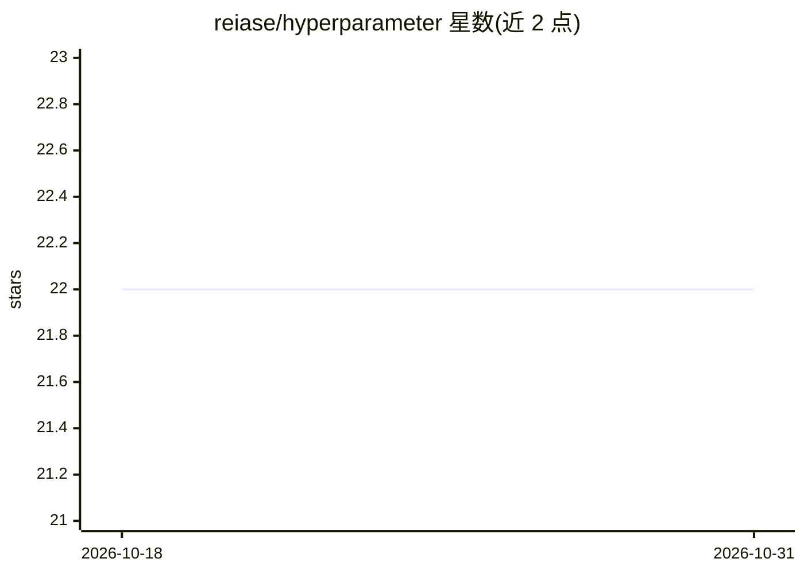

# reiase/hyperparameter

⭐ 22 · Python · Apache-2.0 · 推送 2025-12-14 · [GitHub](https://github.com/reiase/hyperparameter) · [官网](https://reiase.github.io/hyperparameter/) · 个人维护 · 中文 README

**面向 Python/Rust/C++ 的机器学习超参数管理库**

为 AI 研究者与 MLSYS 开发者提供的超参数定义、作用域控制与读取库。Python 端以关键字参数与 with 语句管理参数，支持从 JSON/TOML/YAML 配置文件加载及组合与插值，可用标准类型标注做零依赖 schema 校验；底层由 Rust 实现，为 Rust/C++ 提供宏接口与编译期哈希，并声明跨语言一致的语义契约（作用域优先级、线程隔离、错误模型等）。通过 pip 安装，另支持命令行 -D/--define 方式定义参数，可与 mlflow.tracing 搭配做实验追踪。

## 筛选速览

| 维度 | 判定 | 备注 |
|---|---|---|
| AI 角色 | `ai-ecosystem` | LLM/agent 周边工具 |
| 许可风险 | `permissive` | Apache-2.0 |
| 部署形态 | `library` | 以包/库形式分发 |
| 模型依赖 | — | README 未给出锁定关系 |
| 硬件要求 | — | 无带数字的原话,不猜 |
| 安装摩擦 | `low` | 无编译、无系统依赖或容器化 |
| 成熟度 | — | 结构信号不足 |

## 能力要点

- Python/Rust/C++ 三语言接口，Rust 后端与编译期哈希
- with 语句作用域控制，写入仅影响当前作用域并随退出回滚
- 零依赖 schema 校验（基于标准 Python 类型标注）
- 支持 JSON/TOML/YAML 配置加载与组合、插值及命令行 -D/--define

## 适用场景

- 研究项目中统一管理超参数并使实验可复现
- ML 系统在内层循环高频读取嵌套参数
- 配合 mlflow.tracing 做实验管理与结果追踪

## 场景标签

`MLOps` · 领域:训练与推理

## 证据(README 行号)

> L9: Hyperparameter is a versatile library designed to streamline the management and control of hyperparameters in machin
> L57: - **High-Performance Backend:** Hyperparameter is implemented in Rust, providing a robust and high-performance back

## 星数曲线

2026-10-18 22 → 2026-10-31 22（+0）

---
*卡片 v1 · prompt 1.4 · 生成 2026-10-27 · 置信度 high · 依据 README sha `904486e8cf8e` · [字段定义](../../DATASET.md)*
