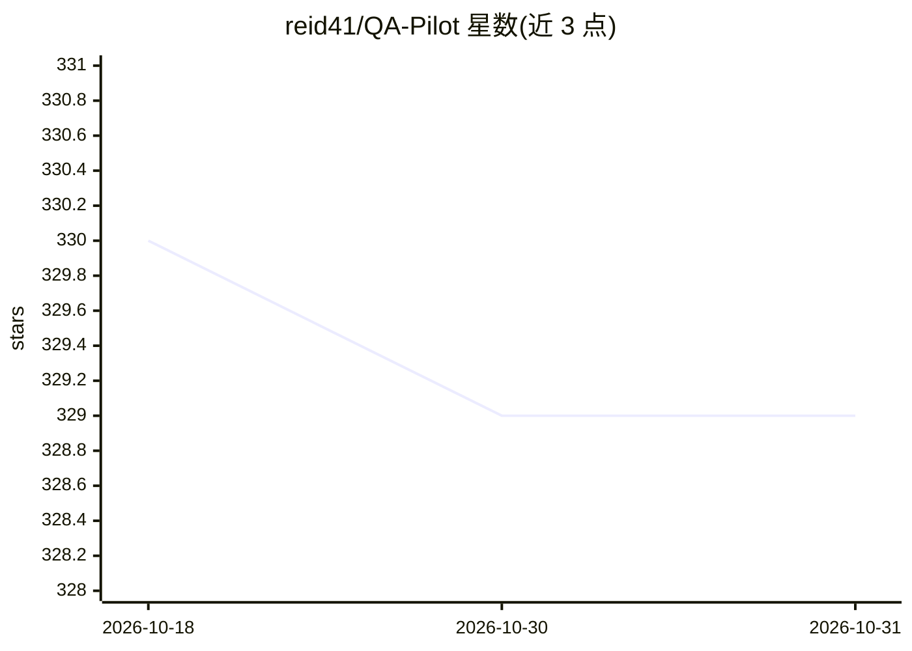

# reid41/QA-Pilot

⭐ 329 · Svelte · Apache-2.0 · 推送 2026-09-14 · [GitHub](https://github.com/reid41/QA-Pilot) · 个人维护 · 中文 README

**基于在线/本地 LLM 的 GitHub 代码库问答聊天应用**

交互式聊天项目：通过 Git 克隆 GitHub 公共仓库或上传本地源码目录建立索引，用户以对话方式理解与导航代码库。支持 ollama、OpenAI、MistralAI、LocalAI、智谱、Anthropic、llama.cpp、NVIDIA、通义、Moonshot、llmman 等多种模型来源，集成 codegraph 查看 Python/Go 文件，提供多会话、历史存储、搜索与 FlashRank 重排。部署需 conda 环境、pip 依赖、PostgreSQL 数据库、Node.js 前端及后端 Python 服务。README 声明为验证本地问答可行性的测试项目，不适用于生产及敏感数据。

## 筛选速览

| 维度 | 判定 | 备注 |
|---|---|---|
| AI 角色 | `ai-native` | 本体是模型或模型工具 |
| 许可风险 | `permissive` | Apache-2.0 |
| 部署形态 | `self-host` | docker 或自建部署 |
| 模型依赖 | local-ok | 支持本地模型 |
| 硬件要求 | — | 无带数字的原话,不猜 |
| 安装摩擦 | `low` | 无编译、无系统依赖或容器化 |
| 成熟度 | `idea` | |

## 能力要点

- 上传本地源码目录或克隆 GitHub 仓库建立对话索引（限 2,000 文件/10 MiB 单文件/50 MiB 总量）
- 接入 11 类模型来源（ollama、OpenAI、Anthropic、llama.cpp、LocalAI、智谱、通义、Moonshot、NVIDIA、MistralAI、llmman）
- Python/Go codegraph 代码视图与 FlashRank 重排搜索（rr: 前缀）
- 多会话管理与聊天历史存储

## 适用场景

- 通过对话快速理解一个陌生 GitHub 仓库的结构与逻辑
- 对本地源码目录做问答式代码导航
- 使用全本地方案（Ollama 等）私有化地进行代码问答

## 场景标签

`文档问答` · 领域:知识与检索

## 证据(README 行号)

> L3: QA-Pilot is an interactive chat project that leverages online/local LLM for rapid understanding and navigation of Gi
> L29: * Support the different LLM models
> L66: * This is a test project to validate the feasibility of a fully local solution for question answering using LLMs an

## 星数曲线

2026-10-18 330 → 2026-10-31 329（-1）

---
*卡片 v1 · prompt 1.4 · 生成 2026-10-21 · 置信度 mid · 依据 README sha `6b432be34d39` · [字段定义](../../DATASET.md)*
