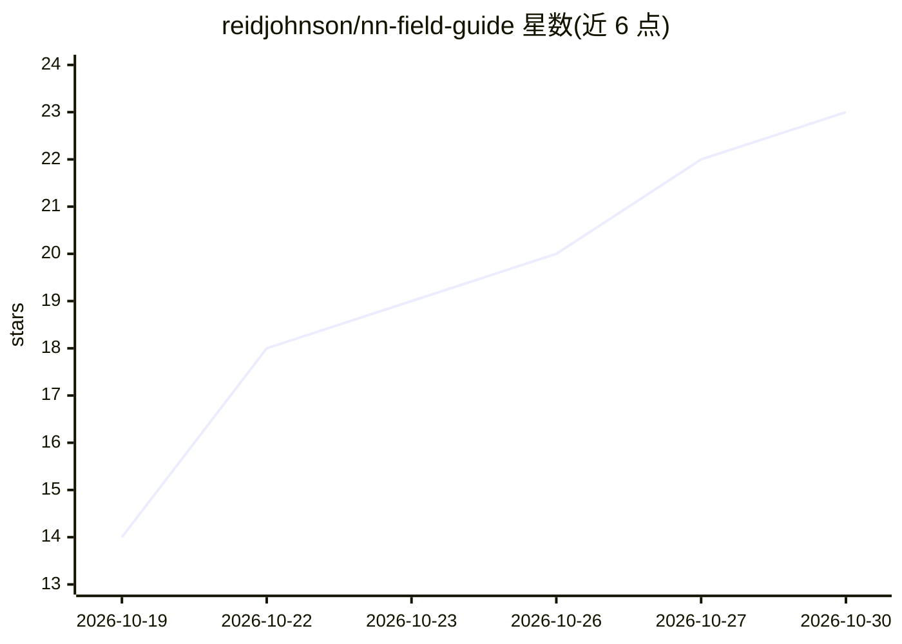

# reidjohnson/nn-field-guide

⭐ 23 · Python · CC-BY-SA-4.0 · 推送 2026-10-25 · [GitHub](https://github.com/reidjohnson/nn-field-guide) · [官网](https://reidjohnson.github.io/nn-field-guide/) · 个人维护

**神经网络结构参考图谱：从感知机到扩散 LLM 的可视化图鉴**

受 Neural Network Zoo 启发的神经网络架构参考图集：以单一规格 architectures.yaml 为源，由 guide.py 统一绘制各架构面板、海报 PDF 与交互网页，覆盖感知机（1958）到 diffusion LLM（2025）。每种细胞用颜色加标记双通道表示角色，连线样式区分权重、跳跃连接、门控、注意力等，适配色盲读者。网页含术语表与逐步讲解图，构建需 Python 3.10+ 与指定字体，测试在 Chromium 中驱动页面并覆盖键盘与屏幕阅读器阅读顺序。

## 筛选速览

| 维度 | 判定 | 备注 |
|---|---|---|
| AI 角色 | `ai-knowledge` | 知识聚合/清单类 |
| 许可风险 | `viral` | CC-BY-SA-4.0 |
| 部署形态 | `library` | 以包/库形式分发 |
| 模型依赖 | — | README 未给出锁定关系 |
| 硬件要求 | — | 无带数字的原话,不猜 |
| 安装摩擦 | `low` | 无编译、无系统依赖或容器化 |
| 成熟度 | — | 结构信号不足 |

## 能力要点

- 单一 YAML 规格驱动面板、海报与网页，三者保持一致
- 颜色+标记双通道图例，色盲读者可读
- 术语表含分步讲解图，网页带无障碍测试（键盘/屏幕阅读器）
- 支持通过 YAML 条目添加新架构与术语，布局自动生成

## 适用场景

- 学习或查阅各类神经网络架构的结构与演化
- 教学或演讲中用作结构讲解的参考图
- 为架构图鉴贡献新的网络条目或术语解释

## 场景标签

`教程课程` · 领域:学习与行业

## 证据(README 行号)

> L7: A reference chart of neural network architectures and training schemes, from the perceptron (1958) to diffusion LLMs
> L35: Everything is drawn by `guide.py` from `architectures.yaml`, so the panels, the poster, and the page always match; 

## 星数曲线

2026-10-19 14 → 2026-10-30 23（+9）

---
*卡片 v1 · prompt 1.4 · 生成 2026-10-27 · 置信度 high · 依据 README sha `dee0e570a304` · [字段定义](../../DATASET.md)*
