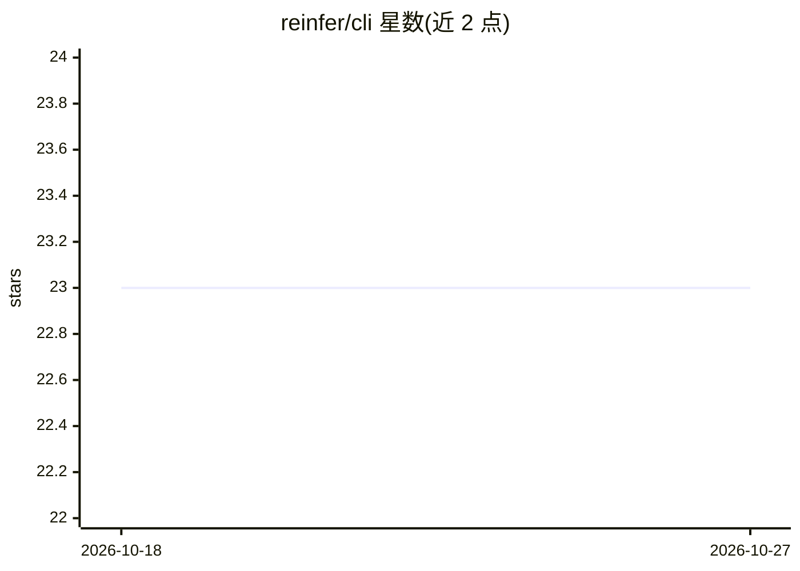

# reinfer/cli

⭐ 23 · Rust · Apache-2.0 · 推送 2026-10-08 · [GitHub](https://github.com/reinfer/cli) · [官网](https://reinfer.io) · 组织维护

**UiPath IXP 平台的官方 CLI 与 Rust API 客户端**

`re` 是 UiPath IXP（原 Re:infer，通信挖掘/NLP 平台）的官方命令行工具，用于管理 sources、datasets、comments 等资源的增删改查，上传 verbatims、批量下载数据与人工标注（用于备份、迁移、转换），并支持多 context 切换不同用户令牌与集群端点，令牌以明文存储于本地配置文件。仓库内 api 目录另含可独立使用的 Rust 客户端库。提供 Linux/macOS/Windows 静态链接二进制、.deb 包与 cargo 安装方式。

## 筛选速览

| 维度 | 判定 | 备注 |
|---|---|---|
| AI 角色 | `ai-ecosystem` | LLM/agent 周边工具 |
| 许可风险 | `permissive` | Apache-2.0 |
| 部署形态 | `desktop` | 安装包/桌面程序 |
| 模型依赖 | — | README 未给出锁定关系 |
| 硬件要求 | — | 无带数字的原话,不猜 |
| 安装摩擦 | `medium` | 含编译或系统依赖之一 |
| 成熟度 | — | 结构信号不足 |

## 能力要点

- sources/datasets/comments 等资源的增删改查操作
- 多 context 管理：切换用户令牌、集群端点与 HTTP 代理
- 批量下载 verbatims 及人工标注，用于备份与数据迁移
- 附带可独立使用的 Rust API 客户端库

## 适用场景

- 通过命令行管理 UiPath IXP 的数据集与来源
- 批量导出通信数据及标注用于备份或迁移
- 在同一工具中切换多个租户/用户的认证凭据

## 场景标签

 · 领域:NLP/通信挖掘平台工具

## 证据(README 行号)

> L21: `re` is the official command line interface for UiPath IXP. It simplifies managing resources, such as sources and d
> L25: The api directory contains a Rust client library for IXP which can be used for API access independently. Please ref

## 星数曲线

2026-10-18 23 → 2026-10-27 23（+0）

---
*卡片 v1 · prompt 1.4 · 生成 2026-10-27 · 置信度 high · 依据 README sha `5ae81593aa2f` · [字段定义](../../DATASET.md)*
