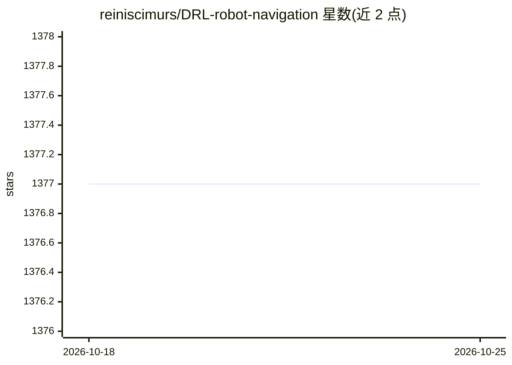

# reiniscimurs/DRL-robot-navigation

⭐ 1,377 · Python · MIT · 推送 2025-12-13 · [GitHub](https://github.com/reiniscimurs/DRL-robot-navigation) · 个人维护

**TD3 深度强化学习训练机器人导航并避障的 ROS Gazebo 实现**

基于 PyTorch 实现 TD3（Twin Delayed Deep Deterministic Policy Gradient）算法，在 ROS Gazebo 仿真器中训练移动机器人导航到随机目标点并避障。障碍通过激光 readings 检测，目标以极坐标给出，使用仿真的 3D Velodyne 传感器。在 Ubuntu 20.04、ROS Noetic、Python 3.8.10、PyTorch 1.10 下测试。提供训练/测试脚本、Tensorboard 监控与 headless 模式 Docker 运行方式，配套 IEEE RA-L/ICRA 2022 论文。

## 筛选速览

| 维度 | 判定 | 备注 |
|---|---|---|
| AI 角色 | `ai-native` | 本体是模型或模型工具 |
| 许可风险 | `permissive` | MIT |
| 部署形态 | `self-host` | docker 或自建部署 |
| 模型依赖 | — | README 未给出锁定关系 |
| 硬件要求 | — | 无带数字的原话,不猜 |
| 安装摩擦 | `low` | 无编译、无系统依赖或容器化 |
| 成熟度 | — | 结构信号不足 |

## 能力要点

- TD3 算法在 ROS Gazebo 中训练机器人导航避障
- 使用仿真 3D Velodyne 激光传感器，也兼容标准 2D 激光
- 提供 Docker headless 训练方式
- 配套 IEEE RA-L / ICRA 2022 论文

## 适用场景

- 在 Gazebo 仿真中训练机器人到达随机目标点并避障
- 复现论文中的 TD3 导航实验
- 作为 DRL 机器人导航的代码参考与二次开发基础

## 场景标签

`强化学习` · 领域:训练与推理

## 证据(README 行号)

> L3: Deep Reinforcement Learning for mobile robot navigation in ROS Gazebo simulator. Using Twin Delayed Deep Determinist
> L56: $ python3 train_velodyne_td3.py

## 星数曲线

2026-10-18 1,377 → 2026-10-25 1,377（+0）

---
*卡片 v1 · prompt 1.4 · 生成 2026-10-21 · 置信度 high · 依据 README sha `f3983c1ef1fe` · [字段定义](../../DATASET.md)*
