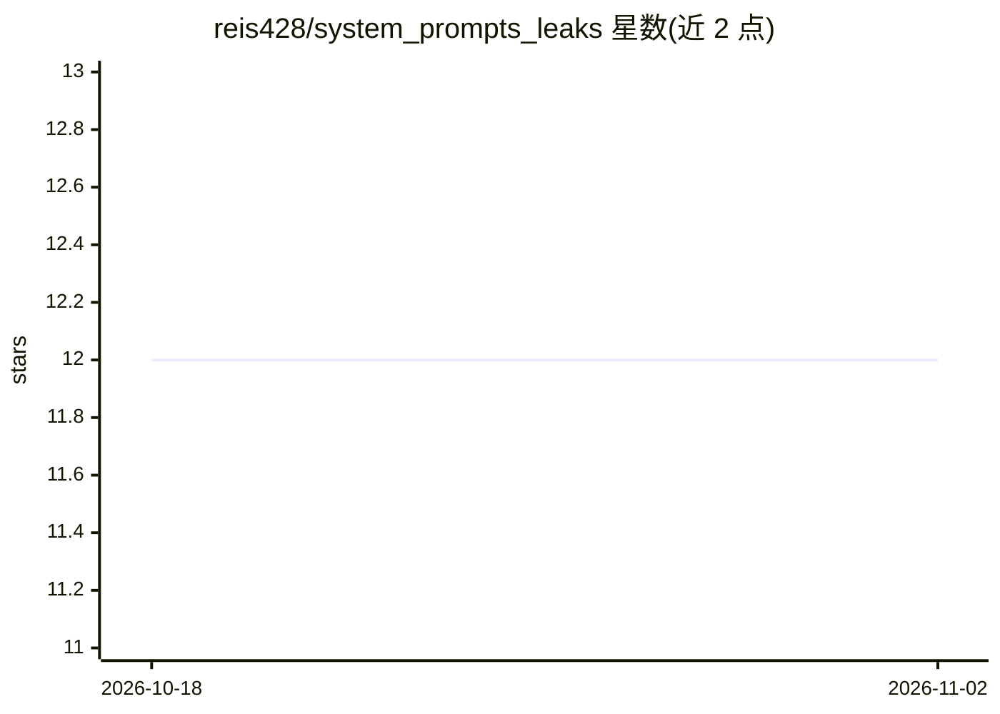

# reis428/system_prompts_leaks

⭐ 12 · JavaScript · 推送 2026-10-12 · [GitHub](https://github.com/reis428/system_prompts_leaks) · 个人维护

**浏览各主流聊天机器人系统提示词合集的桌面应用**

收录从 ChatGPT、Claude、Gemini 等聊天机器人提取的系统提示词，以图形界面应用形式供用户浏览：按聊天机器人或主题分类组织提示词，支持关键词搜索与收藏功能。通过 GitHub Releases 页面下载 zip 压缩包，解压后双击运行，无需编程知识；支持 Windows 10+ 与 macOS Mojave+。README 提示从官方 Releases 页面下载并保持杀毒软件开启。

## 筛选速览

| 维度 | 判定 | 备注 |
|---|---|---|
| AI 角色 | `ai-knowledge` | 知识聚合/清单类 |
| 许可风险 | `none` | — |
| 部署形态 | `desktop` | 安装包/桌面程序 |
| 模型依赖 | — | README 未给出锁定关系 |
| 硬件要求 | — | 无带数字的原话,不猜 |
| 安装摩擦 | `low` | 无编译、无系统依赖或容器化 |
| 成熟度 | — | 结构信号不足 |

## 能力要点

- 收录 ChatGPT、Claude、Gemini 等聊天机器人的系统提示词
- 按聊天机器人或主题分类浏览
- 关键词搜索与收藏功能
-  Releases 页面下载 zip，解压即用，无需编程知识

## 适用场景

- 查看主流聊天机器人的系统提示词写法
- 按分类浏览或搜索感兴趣的提示词
- 收藏常用提示词便于日后查阅

## 场景标签

`提示工程` · 领域:Agent 开发

## 证据(README 行号)

> L7: Welcome to the **system_prompts_leaks** repository. This project is a collection of extracted system prompts from po
> L71: - **Prompt Categories:** Organize prompts by chatbot or subject.

## 星数曲线

2026-10-18 12 → 2026-11-02 12（+0）

---
*卡片 v1 · prompt 1.4 · 生成 2026-11-01 · 置信度 high · 依据 README sha `436e8451c89f` · [字段定义](../../DATASET.md)*
