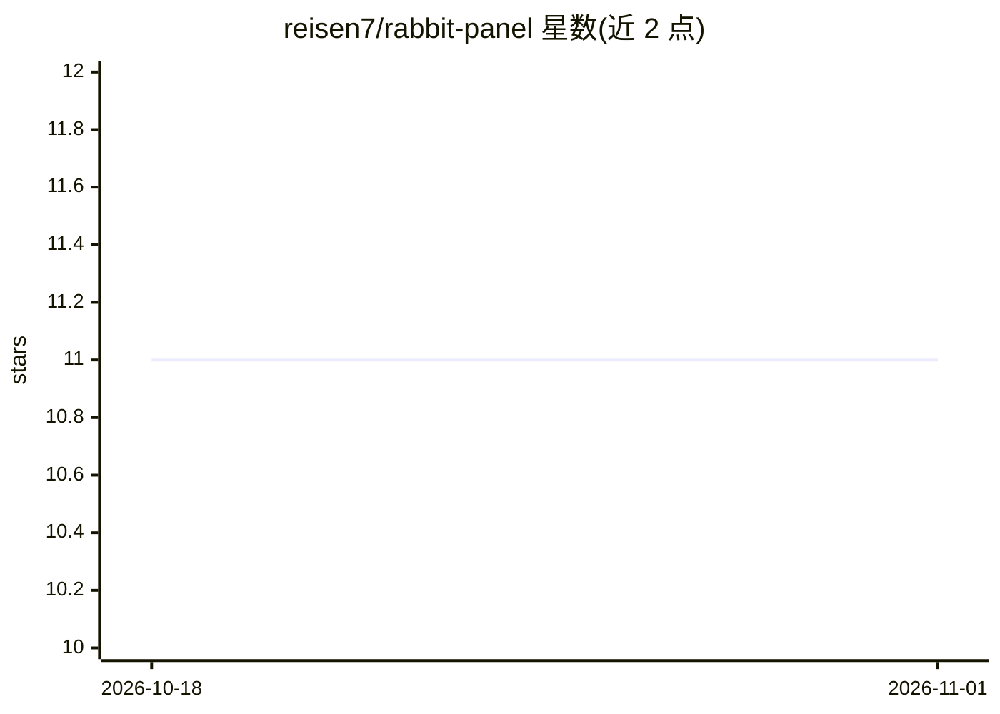

# reisen7/rabbit-panel

⭐ 11 · Go · MIT · 推送 2026-10-22 · [GitHub](https://github.com/reisen7/rabbit-panel) · [官网](https://reisen7.xyz/rabbit-panel/) · 个人维护 · 中文 README

**面向 Linux 服务器的轻量 Docker 运维面板，附 AI 助手**

单二进制、内置前端、SQLite 存储的 Docker 运维面板：管理容器/镜像/网络/存储卷/Compose，支持 Docker 配置、系统监控与 Master/Worker 多节点管理。默认 HTTPS，首次启动自动生成自签证书，支持在线更新与中英文界面。AI 部分：助手支持多种模型接口并可扫码连接微信，智能体可操作已登记的其他节点。提供 Docker、docker compose 与 systemd 一键脚本三种部署方式。

## 筛选速览

| 维度 | 判定 | 备注 |
|---|---|---|
| AI 角色 | `ai-enhanced` | 去掉 AI 部分产品仍成立 |
| 许可风险 | `permissive` | MIT |
| 部署形态 | `self-host` | docker 或自建部署 |
| 模型依赖 | — | README 未给出锁定关系 |
| 硬件要求 | — | 无带数字的原话,不猜 |
| 安装摩擦 | `low` | 无编译、无系统依赖或容器化 |
| 成熟度 | — | 结构信号不足 |

## 能力要点

- 单二进制、内置前端、SQLite 本地存储
- 容器/镜像/网络/存储卷/Compose 管理与 Master/Worker 多节点
- 默认 HTTPS，自动生成自签证书，支持自定义证书与反代场景
- AI 助手支持多种模型接口、可扫码连接微信、智能体可操作其他节点

## 适用场景

- 在 Linux 服务器上通过 Web 界面管理 Docker 容器与 Compose 项目
- 多节点场景下集中管理多台主机的容器
- 通过 AI 助手对话操作已登记节点的运维任务

## 场景标签

 · 领域:运维/容器管理

## 证据(README 行号)

> L3: 一个面向 Linux 服务器的轻量 Docker 运维面板，支持 ARM64 / armv7 / x86_64、多节点管理、AI 助手与在线更新。默认端口 `3958`，默认以 **HTTPS** 提供服务（首次启动自动生成自签证书
> L12: - AI 助手支持多种模型接口，并可扫码连接微信
> L13: - 智能体可以操作已登记的其他节点

## 星数曲线

2026-10-18 11 → 2026-11-01 11（+0）

---
*卡片 v1 · prompt 1.4 · 生成 2026-11-01 · 置信度 high · 依据 README sha `8a12b0285450` · [字段定义](../../DATASET.md)*
