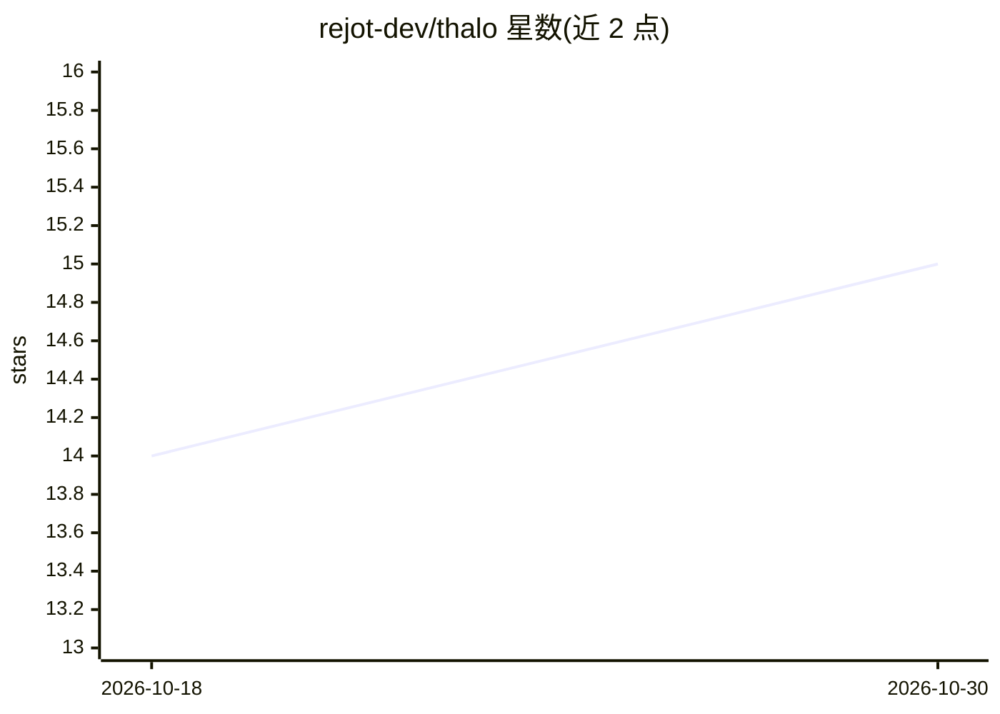

# rejot-dev/thalo

⭐ 15 · TypeScript · MIT · 推送 2026-04-08 · [GitHub](https://github.com/rejot-dev/thalo) · [官网](https://thalo.rejot.dev) · 组织维护

**面向个人知识管理的结构化纯文本格式与 CLI 工具集**

Thalo 是一种纯文本知识记录格式：用实体定义元数据类型系统、标签与条目链接，保持人类可读并可 git 版本控制。配套 thalo-cli 提供 init/check/actualize 命令，内置约 30 条校验规则检查条目 schema 与引用链接，为 LLM/agent 提供反馈循环；actualize 按用户定义查询输出新条目与提示词，可管道交给 LLM 生成综合内容。另有 LSP、VSCode/Cursor 扩展、Prettier 插件与 Tree-sitter 语法。实体定义完全由用户自定义。

## 筛选速览

| 维度 | 判定 | 备注 |
|---|---|---|
| AI 角色 | `ai-ecosystem` | LLM/agent 周边工具 |
| 许可风险 | `permissive` | MIT |
| 部署形态 | `desktop` | 安装包/桌面程序 |
| 模型依赖 | — | README 未给出锁定关系 |
| 硬件要求 | — | 无带数字的原话,不猜 |
| 安装摩擦 | `low` | 无编译、无系统依赖或容器化 |
| 成熟度 | — | 结构信号不足 |

## 能力要点

- 实体定义带简单类型系统（string/link/datetime/enum/数组/联合）
- CLI 内置约 30 条校验规则，校验 schema、引用与链接
- synthesis 查询经 thalo actualize 输出可管道给 LLM 的内容
- 生态含 LSP、VSCode 扩展、Prettier 插件、Tree-sitter 语法

## 适用场景

- 用纯文本文件在 git 中管理个人知识库
- 让 LLM 从零散笔记中提取结构化条目并自动校验
- 用 AI 对知识库条目做综合生成

## 场景标签

`知识库管理` · 领域:知识与检索

## 证据(README 行号)

> L11: Thalo is a plain-text format that gives your knowledge _just enough_ structure for tools and AI to
> L38: ## Thalo provides a feedback loop for agents/LLMs
> L43: The Thalo CLI provides this by validating the schema of entries (e.g. `rating` in the example above)

## 星数曲线

2026-10-18 14 → 2026-10-30 15（+1）

---
*卡片 v1 · prompt 1.4 · 生成 2026-10-30 · 置信度 high · 依据 README sha `d8eb19719a02` · [字段定义](../../DATASET.md)*
