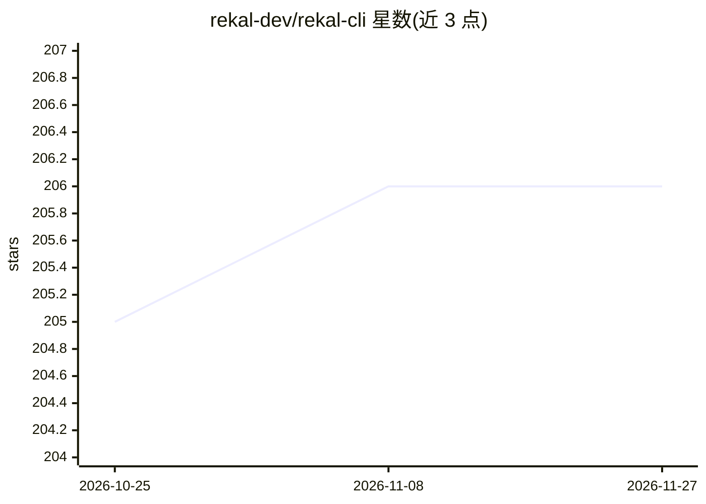

# rekal-dev/rekal-cli

⭐ 206 · Go · Apache-2.0 · 推送 2026-11-15 · [GitHub](https://github.com/rekal-dev/rekal-cli) · [官网](https://rekal.dev) · 个人维护

**给 AI 编码 agent 提供基于 Git 的跨会话记忆与上下文共享**

面向 AI 编码 agent 的本地记忆工具：将 agent 会话与原生记忆笔记修订以 Git 提交形式捕获，本地建立嵌入索引，并通过 Git 分享团队项目上下文；agent 可检索团队与历史上下文并读取原始来源。以单个二进制发布，默认本地嵌入，无需托管记忆账户。支持 macOS ARM64 与 Linux AMD64/ARM64，Apache-2.0 许可，附 arXiv 论文与基准测试文档。

## 筛选速览

| 维度 | 判定 | 备注 |
|---|---|---|
| AI 角色 | `ai-ecosystem` | LLM/agent 周边工具 |
| 许可风险 | `permissive` | Apache-2.0 |
| 部署形态 | `None` |  |
| 模型依赖 | — | README 未给出锁定关系 |
| 硬件要求 | — | 无带数字的原话,不猜 |
| 安装摩擦 | `low` | 无编译、无系统依赖或容器化 |
| 成熟度 | — | 结构信号不足 |

## 能力要点

- 以 Git 提交捕获会话与记忆笔记修订，本地索引
- 默认本地嵌入，单二进制，无需托管账户
- 通过 Git 与团队共享项目上下文（rekal sync）
- 兼容 Claude Code、Cursor、Copilot、Codex 等多种 agent

## 适用场景

- 让 agent 跨会话找回之前的任务上下文与原始来源
- 团队成员间共享 agent 工作记录与项目记忆
- 整合 Claude Code 等多 agent 的本地会话历史检索

## 场景标签

`Agent 记忆` `语义搜索` · 领域:Agent 开发

## 证据(README 行号)

> L25: **Agents own the reasoning. Rekal makes the context durable, retrievable and shared.**
> L29: Works with **Claude Code, Cursor, Copilot, Codex, Gemini, Kiro and OpenCode**.

## 星数曲线

2026-10-25 205 → 2026-11-27 206（+1）

---
*卡片 v1 · prompt 1.4 · 生成 2026-11-25 · 置信度 high · 依据 README sha `402dfce5c0b9` · [字段定义](../../DATASET.md)*
