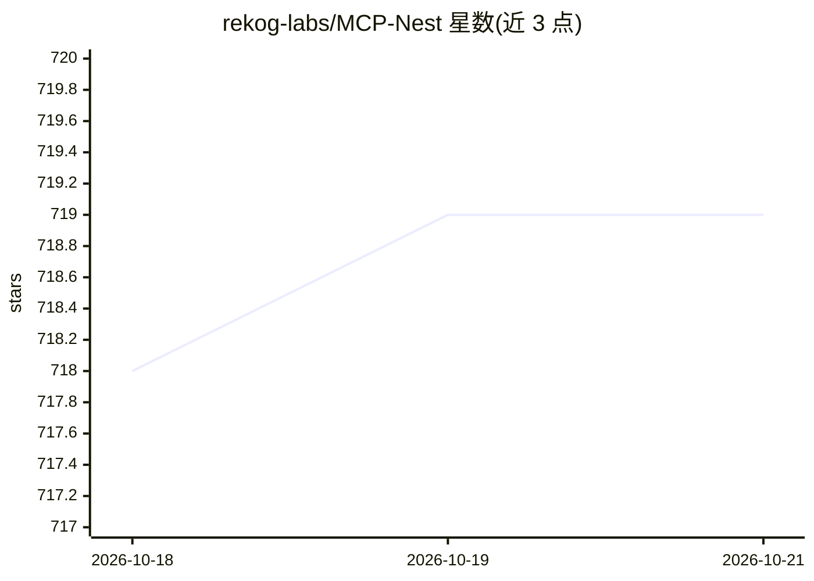

# rekog-labs/MCP-Nest

⭐ 720 · TypeScript · MIT · 推送 2026-10-20 · [GitHub](https://github.com/rekog-labs/MCP-Nest) · 组织维护

**NestJS 模块：用注解把应用方法暴露为 MCP 服务器**

面向 NestJS 开发者的 MCP 服务器构建模块：以微服务传输策略运行，通过 @McpController 与 @Tool 等注解定义工具、资源和提示词模板，NestJS 的守卫、管道、拦截器原生生效，支持依赖注入复用既有代码。支持 Streamable HTTP 与 STDIO 传输，同一端点并发服务 2025 协议与无状态 2026-07-28 修订版。内置授权服务器为 Beta，另支持 Keycloak/Auth0 等外部授权。

## 筛选速览

| 维度 | 判定 | 备注 |
|---|---|---|
| AI 角色 | `ai-ecosystem` | LLM/agent 周边工具 |
| 许可风险 | `permissive` | MIT |
| 部署形态 | `library` | 以包/库形式分发 |
| 模型依赖 | — | README 未给出锁定关系 |
| 硬件要求 | — | 无带数字的原话,不猜 |
| 安装摩擦 | `low` | 无编译、无系统依赖或容器化 |
| 成熟度 | — | 结构信号不足 |

## 能力要点

- 工具/资源/提示词即 NestJS @MessagePattern 处理器，守卫管道拦截器原生适用
- 同一端点并发服务 2025 协议与 2026-07-28 无状态修订版
- Streamable HTTP 与 STDIO 多传输支持
- Elicitation、按工具授权、基于 Guard 的 OAuth 认证

## 适用场景

- 在既有 NestJS 应用中暴露 MCP 工具供 AI agent 调用
- 构建带认证与细粒度授权的 MCP 服务器
- 以 STDIO 或 HTTP 传输接入 MCP 客户端

## 场景标签

 · 领域:LLM 基础设施/MCP

## 证据(README 行号)

> L9: A NestJS module to effortlessly expose tools, resources, and prompts for AI, from your NestJS applications using the
> L11: With `@rekog/mcp-nest` you define tools, resources, and prompts in a way that's familiar in NestJS and leverage the

## 星数曲线

2026-10-18 718 → 2026-10-21 719（+1）

---
*卡片 v1 · prompt 1.4 · 生成 2026-10-22 · 置信度 high · 依据 README sha `4d1eb52ed3fa` · [字段定义](../../DATASET.md)*
