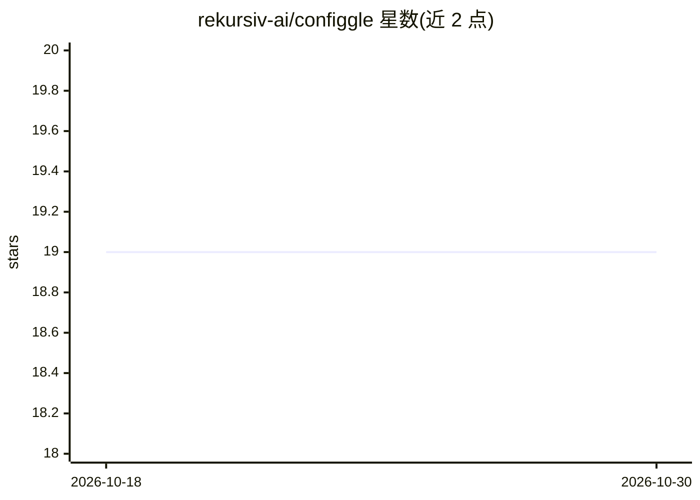

# rekursiv-ai/configgle

⭐ 19 · Python · Apache-2.0 · 推送 2026-10-29 · [GitHub](https://github.com/rekursiv-ai/configgle) · [官网](https://rekursiv.ai) · 组织维护

**面向 ML 实验的类型安全分层配置库（dataclass 工厂+依赖注入）**

纯 Python 数据类配置库：以嵌套 dataclass 定义分层实验配置，通过类型化工厂方法 make() 构建对象，支持继承（Makes/Makes2 标注）、协变 Makeable 协议、finalize 前后阶段派生字段、update 批量修改、copy_tree 半深拷贝、traverse 遍历替换、pprint/udiff 打印与 diff、serialize/deserialize 序列化（保留嵌套类与 DAG 身份）、CLI 覆盖与 pickle/cloudpickle。面向深度学习实验开发者，一等支持 ty/basedpyright/pyrefly 类型检查器；@autofig 可从 __init__ 自动生成 Config。反序列化会导入 payload 中模块，需只加载可信数据。

## 筛选速览

| 维度 | 判定 | 备注 |
|---|---|---|
| AI 角色 | `ai-ecosystem` | LLM/agent 周边工具 |
| 许可风险 | `permissive` | Apache-2.0 |
| 部署形态 | `library` | 以包/库形式分发 |
| 模型依赖 | — | README 未给出锁定关系 |
| 硬件要求 | — | 无带数字的原话,不猜 |
| 安装摩擦 | `low` | 无编译、无系统依赖或容器化 |
| 成熟度 | — | 结构信号不足 |

## 能力要点

- make() 类型安全工厂与协变 Makeable 协议，ty/basedpyright/pyrefly 一等支持
- finalize() pre/super/post 分阶段派生字段，配置树仅最终化一次
- serialize/deserialize 保留嵌套类、多态槽位、DAG 身份与循环，使用 jsonpickle 词汇
- CLI 覆盖 apply_overrides + python -m configgle 启动器，@autofig 零样板生成 Config

## 适用场景

- 深度学习实验中用纯 Python 函数定义与切换基线配置
- 通过命令行 --override 修改嵌套配置字段后直接运行实验
- 对多组实验配置做 diff 对比与配置感知打印
- 分布式工作流中用 cloudpickle 跨进程传递配置

## 场景标签

 · 领域:机器学习工程/配置管理

## 证据(README 行号)

> L9: Type-safe hierarchical experiment configuration using pure Python dataclass factories and dependency injection.
> L20: Hierarchical experiment configuration using pure Python dataclasses with typed
> L32: Configs are plain mutable dataclasses, so experiments are just functions that

## 星数曲线

2026-10-18 19 → 2026-10-30 19（+0）

---
*卡片 v1 · prompt 1.4 · 生成 2026-10-28 · 置信度 mid · 依据 README sha `b0859956d67b` · [字段定义](../../DATASET.md)*
