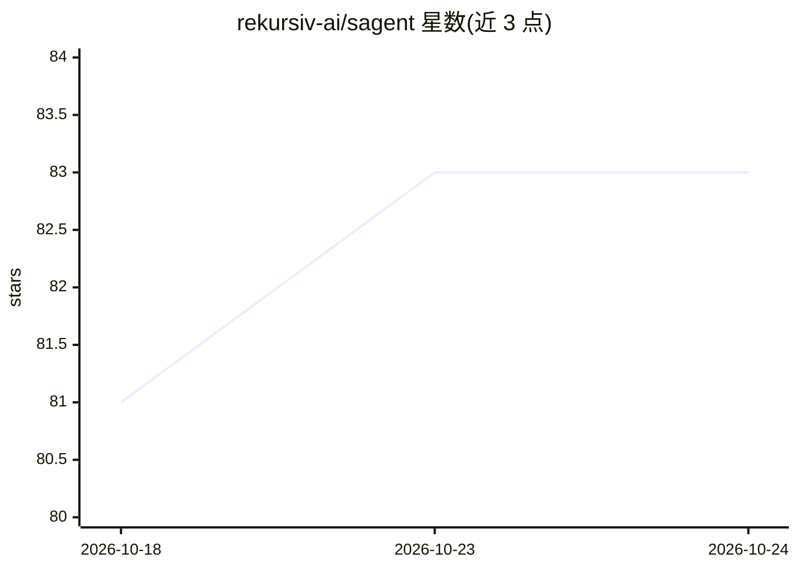

# rekursiv-ai/sagent

⭐ 83 · Python · Apache-2.0 · 推送 2026-10-23 · [GitHub](https://github.com/rekursiv-ai/sagent) · [官网](https://rekursiv.ai) · 组织维护

**多供应商编码 agent CLI 与强类型 Python 库**

提供命令行编码代理与可导入的 Python 库两种形态：支持 Anthropic、OpenAI、Google、Moonshot、DashScope、MiniMax、OpenAI 兼容端点及本地 HuggingFace/llama.cpp 后端；会话中可热切换供应商与模型，代理可递归派生并点对点通信，跨供应商统一美元计费与预算上限。同一 Agent 类驱动 CLI、应用代码与子代理。需 Python 3.12+；自身非沙箱，工具以当前进程权限执行。

## 筛选速览

| 维度 | 判定 | 备注 |
|---|---|---|
| AI 角色 | `ai-ecosystem` | LLM/agent 周边工具 |
| 许可风险 | `permissive` | Apache-2.0 |
| 部署形态 | `library` | 以包/库形式分发 |
| 模型依赖 | local-ok | 支持本地模型 |
| 硬件要求 | — | 无带数字的原话,不猜 |
| 安装摩擦 | `medium` | 含编译或系统依赖之一 |
| 成熟度 | — | 结构信号不足 |

## 能力要点

- 单一 CLI 接入 Anthropic/OpenAI/Google/Moonshot/DashScope/MiniMax/OpenAI 兼容端点及本地 llama.cpp
- 会话中热切换供应商、模型与思考强度，无需重启
- 递归代理派生与点对点 AgentSend 消息
- 同一 Agent 类驱动 CLI、应用代码与递归子代理

## 适用场景

- 在终端用自然语言驱动多供应商编码代理完成任务
- 把强类型 Agent/Tool/Model 对象嵌入自己的 Python 项目
- 通过 --max-budget-usd 限制多代理任务的 API 总支出

## 场景标签

`Agent 框架` `编码 Agent` · 领域:Agent 开发

## 证据(README 行号)

> L68: - **One runtime, every surface.** The same `Agent` class powers the CLI, your application code, and recursive sub-a

## 星数曲线

2026-10-18 81 → 2026-10-24 83（+2）

---
*卡片 v1 · prompt 1.4 · 生成 2026-10-24 · 置信度 high · 依据 README sha `e1a5e736e6b1` · [字段定义](../../DATASET.md)*
