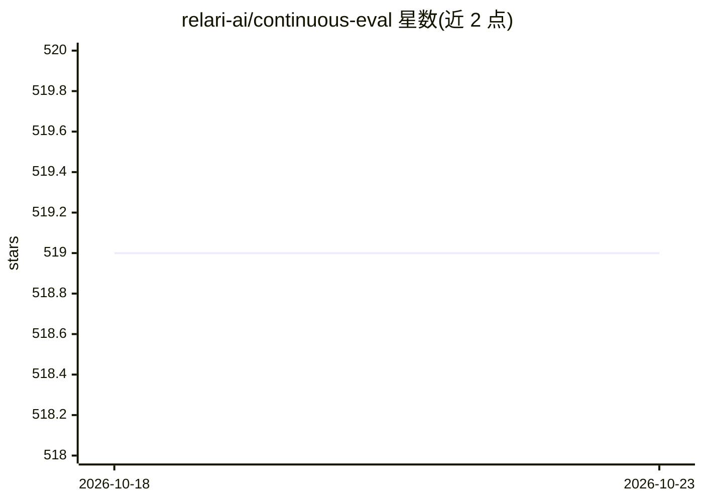

# relari-ai/continuous-eval

⭐ 519 · Python · Apache-2.0 · 推送 2026-08-10 · [GitHub](https://github.com/relari-ai/continuous-eval) · [官网](https://continuous-eval.docs.relari.ai/) · 组织维护

**面向 LLM 应用的数据驱动评测框架（含 RAG/Agent/代码生成指标库）**

continuous-eval 是用于 LLM 应用数据驱动评测的 Python 包：提供模块化评测（按 pipeline 各模块配指标）、覆盖 RAG、代码生成、Agent 工具调用、分类等场景的指标库，可混合确定性、语义与 LLM-as-a-Judge 指标，并支持概率化评测。通过 EvaluationRunner 在数据集上运行评测，或定义多模块 pipeline 做粒度化评测；可用 CustomMetric 类自定义 LLM 评审指标。以 PyPI 包分发，也可源码安装；运行 LLM 类指标需配置至少一个 LLM API key。Apache 2.0 许可。

## 筛选速览

| 维度 | 判定 | 备注 |
|---|---|---|
| AI 角色 | `ai-ecosystem` | LLM/agent 周边工具 |
| 许可风险 | `permissive` | Apache-2.0 |
| 部署形态 | `library` | 以包/库形式分发 |
| 模型依赖 | — | README 未给出锁定关系 |
| 硬件要求 | — | 无带数字的原话,不猜 |
| 安装摩擦 | `low` | 无编译、无系统依赖或容器化 |
| 成熟度 | — | 结构信号不足 |

## 能力要点

- 模块化评测：按 pipeline 模块配置各自指标
- 指标库覆盖 RAG/代码生成/Agent 工具调用/分类，支持确定性/语义/LLM 三类指标混合
- CustomMetric 类支持自定义 LLM-as-a-Judge 指标
- 支持概率化评测与并行执行

## 适用场景

- 为 RAG pipeline 的检索与生成模块分别做指标评测
- 在数据集上批量运行 LLM 应用评测并输出结果
- 构建自定义 LLM-as-a-Judge 指标评估生成质量

## 场景标签

`模型评测` · 领域:评测与运维

## 证据(README 行号)

> L16: `continuous-eval` is an open-source package created for data-driven evaluation of LLM-powered application.
> L24: - **Modularized Evaluation**: Measure each module in the pipeline with tailored metrics.
> L26: - **Comprehensive Metric Library**: Covers Retrieval-Augmented Generation (RAG), Code Generation, Agent Tool Use, C

## 星数曲线

2026-10-18 519 → 2026-10-23 519（+0）

---
*卡片 v1 · prompt 1.4 · 生成 2026-10-21 · 置信度 high · 依据 README sha `71d4dcdbde89` · [字段定义](../../DATASET.md)*
