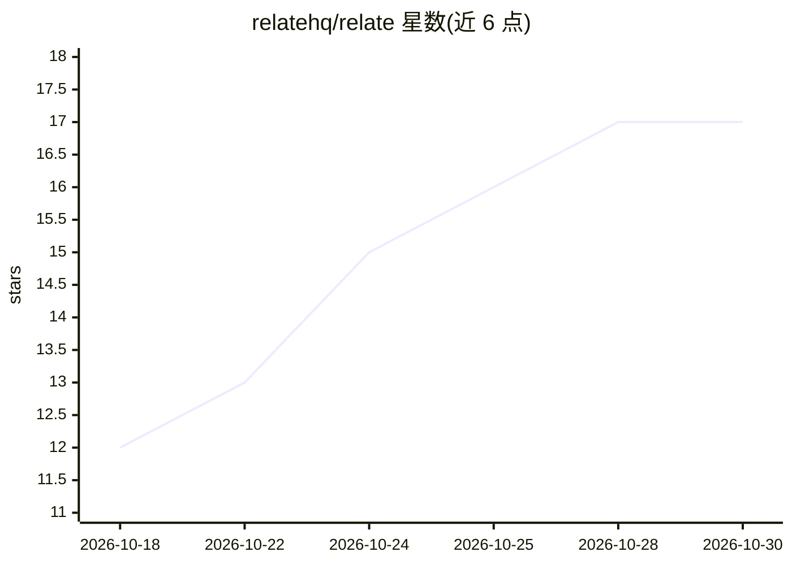

# relatehq/relate

⭐ 17 · TypeScript · Apache-2.0 · 推送 2026-10-28 · [GitHub](https://github.com/relatehq/relate) · [官网](https://relatehq.dev) · 组织维护

**TypeScript 业务数据建模库：带权限与证据的统一读取 API**

用 TypeScript 描述业务对象（客户、发票、评论）、字段来源、对象关系与访问规则的应用内嵌库。应用与 agent 经一个类型化 API 跨 CRM、计费数据库等系统读取，每次读取按调用者过滤并附带每字段来源与新鲜度；写入以带收据的幂等 action 执行。内嵌 Node 运行，经 MCP 工具（discover/execute）向 agent 暴露图访问。版本 0.0.0-dev.0，未发布 npm，作者自称早期、不适用于生产；提供 SQLite、PostgreSQL/DuckDB、Stripe 与只读 Salesforce 连接器。

## 筛选速览

| 维度 | 判定 | 备注 |
|---|---|---|
| AI 角色 | `ai-ecosystem` | LLM/agent 周边工具 |
| 许可风险 | `permissive` | Apache-2.0 |
| 部署形态 | `library` | 以包/库形式分发 |
| 模型依赖 | — | README 未给出锁定关系 |
| 硬件要求 | — | 无带数字的原话,不猜 |
| 安装摩擦 | `low` | 无编译、无系统依赖或容器化 |
| 成熟度 | `idea` | |

## 能力要点

- 访问规则声明在模型中，读取/遍历/操作统一执行
- 每字段 provenance 与 freshness 证据，可设时效上限
- 带收据的幂等事务 action
- 内嵌 MCP（stdio/Streamable HTTP）暴露 discover/execute 两工具

## 适用场景

- 让应用和 agent 跨多个业务系统做权限一致的统一读取
- 为 agent 提供按用户权限过滤且可溯源的数据访问
- 以幂等收据方式执行业务写入操作

## 场景标签

`知识图谱` · 领域:知识与检索

## 证据(README 行号)

> L8: application and agents then read across your CRM, billing database and other
> L167: through two MCP tools: `discover` and `execute`. Both stdio and Streamable HTTP
> L187: 4. **Agents.** The MCP interface exposes `discover` and `execute`. Does this

## 星数曲线

2026-10-18 12 → 2026-10-30 17（+5）

---
*卡片 v1 · prompt 1.4 · 生成 2026-10-29 · 置信度 mid · 依据 README sha `0c53f79d521c` · [字段定义](../../DATASET.md)*
