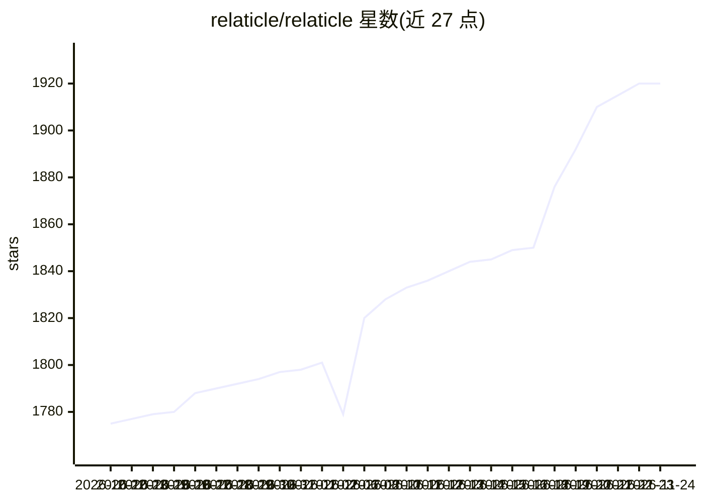

# relaticle/relaticle

⭐ 1,920 · PHP · AGPL-3.0 · 推送 2026-11-22 · [GitHub](https://github.com/relaticle/relaticle) · [官网](https://relaticle.com) · 组织维护

**面向无销售团队卖家的自托管 AI CRM**

自托管 CRM，管理公司、联系人、商机、任务与笔记，支持自定义字段（含逐字段加密）、REST API 与多工作区隔离、基于角色的权限。核心接入机制为内置 MCP 服务器（Streamable HTTP、OAuth 2.1 或个人访问令牌），可连接 Claude、ChatGPT 或自建 agent 读取、写入与分析 CRM 数据；内置 AI 助手 Rela 可将一次请求拆解为多条变更，经用户批准后应用。基于 Laravel/Filament 技术栈，提供 Docker 六容器部署与源码安装。AGPL-3.0，cloud 代码除外。

## 筛选速览

| 维度 | 判定 | 备注 |
|---|---|---|
| AI 角色 | `ai-enhanced` | 去掉 AI 部分产品仍成立 |
| 许可风险 | `viral` | AGPL-3.0 |
| 部署形态 | `self-host` | docker 或自建部署 |
| 模型依赖 | locked-api |  |
| 硬件要求 | — | 无带数字的原话,不猜 |
| 安装摩擦 | `low` | 无编译、无系统依赖或容器化 |
| 成熟度 | — | 结构信号不足 |

## 能力要点

- 内置 MCP 服务器，支持 Claude/ChatGPT/自建 agent 接入
- REST API 提供完整 CRUD、schema 访问与管线分析
- 自定义字段与逐字段加密，无需迁移
- 多工作区隔离与基于角色的权限

## 适用场景

- 独自向固定客户名单销售、无需销售团队时管理商机
- 让 AI agent 读取并更新自托管的 CRM 数据
- 自托管部署并保持数据在自己服务器上

## 场景标签

 · 领域:企业应用/CRM

## 证据(README 行号)

> L25: Relaticle is a self-hosted CRM your AI agents can work in. Connect Claude, ChatGPT, or an open-source model over MC
> L31: - **Agent-Native Infrastructure** - MCP server and REST API with full CRUD, schema access, activity history, and pi

## 星数曲线

2026-10-22 1,775 → 2026-11-24 1,920（+145）

---
*卡片 v1 · prompt 1.4 · 生成 2026-11-23 · 置信度 high · 依据 README sha `deabe0ffb122` · [字段定义](../../DATASET.md)*
