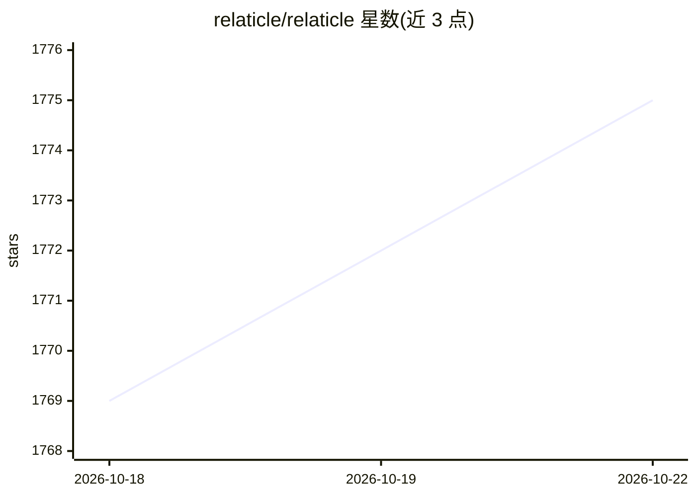

# relaticle/relaticle

⭐ 1,777 · PHP · AGPL-3.0 · 推送 2026-10-22 · [GitHub](https://github.com/relaticle/relaticle) · [官网](https://relaticle.com) · 组织维护

**面向 AI agent 的自托管开源 CRM，通过 MCP 读写 CRM 数据**

基于 Laravel 13、Filament 5、PHP 8.5 构建的自托管 CRM，提供 MCP server 与 REST API（含完整 CRUD、schema 访问、活动历史与 pipeline 分析），可连接 Claude、ChatGPT 或开源模型，让 AI agent 读写和分析 CRM 数据。支持自定义字段（含字段级加密，无需迁移）、多工作区隔离与角色权限。需 PHP 8.5+、PostgreSQL 17+、Composer 与 Node.js 22+，通过 git clone 安装；AGPL-3.0 许可。

## 筛选速览

| 维度 | 判定 | 备注 |
|---|---|---|
| AI 角色 | `ai-enhanced` | 去掉 AI 部分产品仍成立 |
| 许可风险 | `viral` | AGPL-3.0 |
| 部署形态 | `None` |  |
| 模型依赖 | — | README 未给出锁定关系 |
| 硬件要求 | — | 无带数字的原话,不猜 |
| 安装摩擦 | `low` | 无编译、无系统依赖或容器化 |
| 成熟度 | — | 结构信号不足 |

## 能力要点

- MCP server 提供 37 个工具，供 AI agent 读写分析 CRM 数据
- 自定义字段支持文本/日期/货币/选项与记录间链接，带字段级加密
- 多工作区数据隔离与角色权限
- 自托管、AGPL-3.0，提供 REST API

## 适用场景

- 团队用自托管 CRM 管理公司、联系人、笔记等数据
- 让 Claude/ChatGPT 等模型通过 MCP 直接操作 CRM
- 通过 REST API 集成到自有业务系统

## 场景标签

 · 领域:企业管理软件/CRM

## 证据(README 行号)

> L25: Relaticle is a self-hosted CRM your AI agents can work in. Connect Claude, ChatGPT, or an open-source model over MC
> L31: - **Agent-Native Infrastructure** - MCP server and REST API with full CRUD, schema access, activity history, and pi

## 星数曲线

2026-10-18 1,769 → 2026-10-22 1,775（+6）

---
*卡片 v1 · prompt 1.4 · 生成 2026-10-21 · 置信度 high · 依据 README sha `250788a471e8` · [字段定义](../../DATASET.md)*
