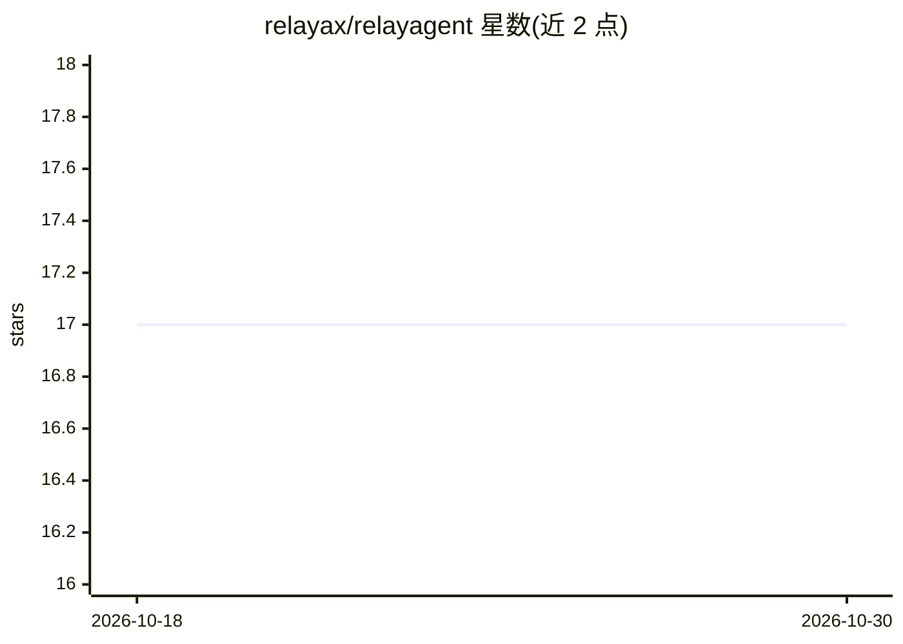

# relayax/relayagent

⭐ 17 · TypeScript · MIT · 推送 2026-08-30 · [GitHub](https://github.com/relayax/relayagent) · [官网](https://relayax.com) · 个人维护 · 中文 README

**运行自带界面的 agent 包的个人底座运行时**

Node.js 实现的本地 agent 包运行时：一个包 = 一个 agent + 它自己的 Web 界面（view），由单一 manifest（relay.yaml）声明 agent、动词（scripts）、界面、渠道、服务、触发器与不可触碰范围。manifest 为唯一结构事实源，安装失败即报错，凭据存入 vault（macOS Keychain 或 0600 文件），包间依赖以可审计的 grant 记录在 ledger。内置共享 harness 适配器池（Claude Code、Codex、Kimi、Pi），agent 以中立格式交付由适配器翻译。要求 Node.js 22.6+ 与已登录的 Claude Code CLI，自述处于 seed 阶段。

## 筛选速览

| 维度 | 判定 | 备注 |
|---|---|---|
| AI 角色 | `ai-ecosystem` | LLM/agent 周边工具 |
| 许可风险 | `permissive` | MIT |
| 部署形态 | `library` | 以包/库形式分发 |
| 模型依赖 | locked-api |  |
| 硬件要求 | — | 无带数字的原话,不猜 |
| 安装摩擦 | `low` | 无编译、无系统依赖或容器化 |
| 成熟度 | `idea` | |

## 能力要点

- 单一 relay.yaml manifest 声明包的全部结构与边界，manifest 外文件对底座不存在
- 共享 harness 适配器池内置 Claude Code / Codex / Kimi / Pi，按能力声明选择
- 凭据存 vault、包间依赖以 ledger 中的 grant 记录，声明为上限
- 安装时构建 view 界面并由 daemon 托管在 /pkg/<name>/view/

## 适用场景

- 我在本地安装并运行带自有操作界面的 agent 包，而非只得到聊天窗口
- 我通过 manifest 与 grant 机制审计 agent 包的权限与包间依赖
- 我用 GitHub/Discord/Slack 等渠道作为同一 agent 软件的额外入口

## 场景标签

`Agent 框架` · 领域:Agent 开发

## 证据(README 行号)

> L13: RelayAgent is a personal substrate for agent packages that ship their own screens.
> L27: |Harness|The execution adapter that runs a package's agents. **Adapters are shared, not per-package**: the console 

## 星数曲线

2026-10-18 17 → 2026-10-30 17（+0）

---
*卡片 v1 · prompt 1.4 · 生成 2026-10-29 · 置信度 high · 依据 README sha `45324deb48ec` · [字段定义](../../DATASET.md)*
