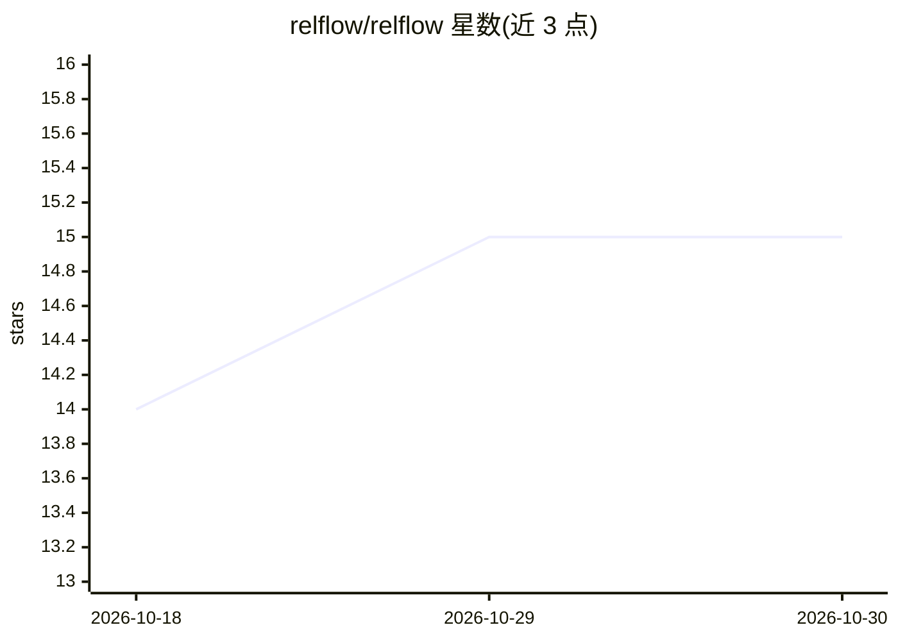

# relflow/relflow

⭐ 15 · Python · Apache-2.0 · 推送 2026-10-29 · [GitHub](https://github.com/relflow/relflow) · [官网](http://relflow.ai) · 组织维护

**在嵌套结构化数据上训练 PyTorch 模型的机器学习库**

relflow 从经 Apache Arrow 流式输入的嵌套记录构建 PyTorch/Lightning 模型：类型化字段表示值，分支（Branch）组合出局部上下文，解码器从上下文学习预测指定目标字段（如支付是否被拒付）。应用侧提供 Arrow 表格作为训练/验证/请求集，训练含早停与最优模型恢复，支持 EMA、检查点续训、嵌入输出与流式写出 Parquet。以 Python 库形式发布于 PyPI，需 Python 3.11+，可选 Hugging Face 文本编码器与 HTTP 服务运行时扩展。

## 筛选速览

| 维度 | 判定 | 备注 |
|---|---|---|
| AI 角色 | `ai-native` | 本体是模型或模型工具 |
| 许可风险 | `permissive` | Apache-2.0 |
| 部署形态 | `library` | 以包/库形式分发 |
| 模型依赖 | — | README 未给出锁定关系 |
| 硬件要求 | — | 无带数字的原话,不猜 |
| 安装摩擦 | `low` | 无编译、无系统依赖或容器化 |
| 成熟度 | — | 结构信号不足 |

## 能力要点

- 从嵌套结构化记录（非扁平表格）构建 PyTorch/Lightning 模型
- mask=True 声明监督目标，Branch 支持交易历史等重复上下文
- 早停、EMA 权重平均、检查点恢复与 Parquet 流式预测输出
- 可选 relflow[text]（HF 文本编码器）与 relflow[serving]（HTTP 运行时）

## 适用场景

- 在含交易历史的支付拒付数据上训练预测模型
- 对嵌套/多表结构数据做端到端训练与批量推理
- 获取结构化数据的表示嵌入用于下游任务

## 场景标签

 · 领域:机器学习/结构化数据建模

## 证据(README 行号)

> L13: relflow builds PyTorch/Lightning models from nested records streamed through
> L30: For example, predict whether a payment will be disputed:

## 星数曲线

2026-10-18 14 → 2026-10-30 15（+1）

---
*卡片 v1 · prompt 1.4 · 生成 2026-10-30 · 置信度 high · 依据 README sha `a519bfe31593` · [字段定义](../../DATASET.md)*
