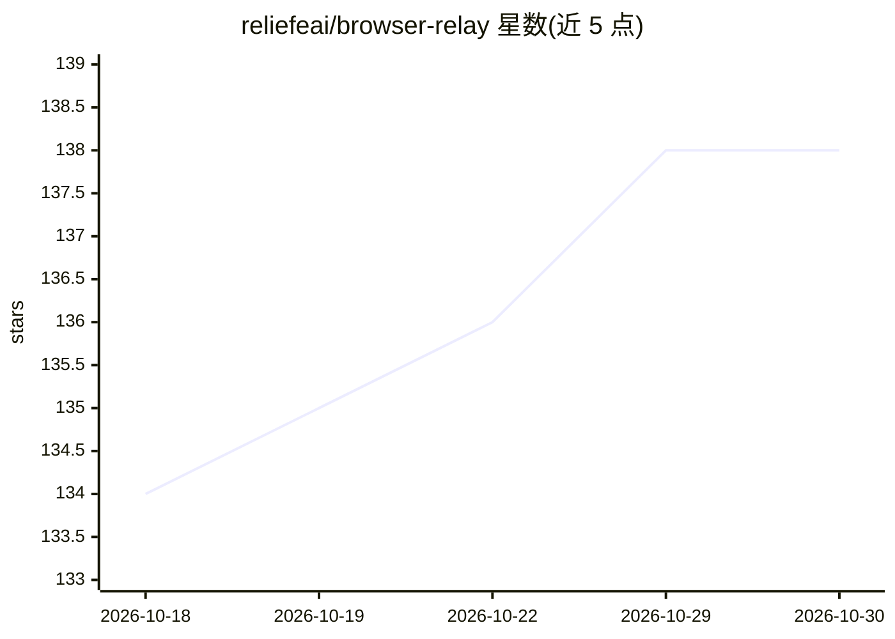

# reliefeai/browser-relay

⭐ 138 · JavaScript · MIT · 推送 2026-09-17 · [GitHub](https://github.com/reliefeai/browser-relay) · [官网](https://www.npmjs.com/package/@linsoai/browser-relay) · 组织维护 · 中文 README

**让 AI agent 共享你已登录 Chrome 的 Skill+CLI 工具**

面向 AI agent 的浏览器接入层：通过 npm 包内置的 Agent Skill 与 CLI，让 Claude Code、Codex、Cursor 等 agent 操作用户日常使用的 Chrome（保留 cookies、扩展与登录态），而非启动空白自动化配置。本地默认绑定 127.0.0.1 的 relay 服务经 WebSocket 转发 Chrome DevTools Protocol 命令到扩展；远程模式由浏览器向外连接公共 relay 服务，可用 Device ID 跨机控制，支持一键自部署 Cloudflare Worker。提供 MCP 服务器、JSON 输出、页面快照标注与动作编排。需桌面版 Chrome 与 Node.js/npm。

## 筛选速览

| 维度 | 判定 | 备注 |
|---|---|---|
| AI 角色 | `ai-ecosystem` | LLM/agent 周边工具 |
| 许可风险 | `permissive` | MIT |
| 部署形态 | `library` | 以包/库形式分发 |
| 模型依赖 | — | README 未给出锁定关系 |
| 硬件要求 | — | 无带数字的原话,不猜 |
| 安装摩擦 | `low` | 无编译、无系统依赖或容器化 |
| 成熟度 | — | 结构信号不足 |

## 能力要点

- 复用已登录的日常 Chrome 会话，不另起自动化配置
- 本地默认绑定 127.0.0.1，远程模式无公开端口、浏览器外连公共 relay
- 内置 Agent Skill 安装（claude-code/codex 等）与 MCP 服务器（browser_click/browser_snapshot 等工具）
- 可一键将自建 relay 部署到自己的 Cloudflare 账号

## 适用场景

- 让本机或手机上的 agent 操作我已登录的内部系统/SaaS 面板
- CI 机器或远程 agent 通过 Device ID 跨机控制我的浏览器
- agent 在真实浏览器上下文中做页面读取、表单填写与调试（console/network 捕获）

## 场景标签

`浏览器自动化` · 领域:效率与自动化

## 证据(README 行号)

> L30: Browser Relay lets an AI agent join the Chrome browser you already use through an agent-native **Skill + CLI**. It 
> L43: - **Agent-first** — install the bundled Skill so Claude Code, Codex, Cursor, Windsurf, and other agents know when a
> L54:   AI Agent ──Skill + CLI──▶ Relay server (Node, 127.0.0.1)

## 星数曲线

2026-10-18 134 → 2026-10-30 138（+4）

---
*卡片 v1 · prompt 1.4 · 生成 2026-10-22 · 置信度 high · 依据 README sha `a3ae9ab4432e` · [字段定义](../../DATASET.md)*
