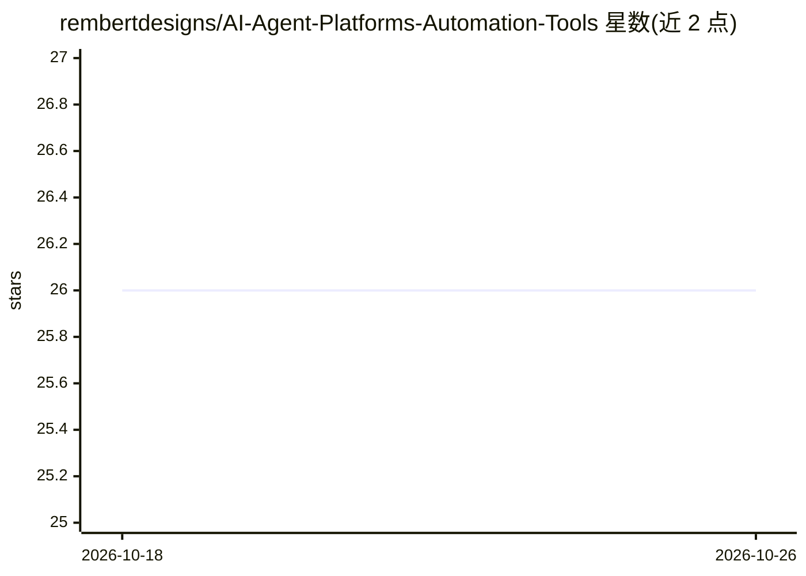

# rembertdesigns/AI-Agent-Platforms-Automation-Tools

⭐ 26 · MIT · 推送 2025-10-30 · [GitHub](https://github.com/rembertdesigns/AI-Agent-Platforms-Automation-Tools) · 个人维护

**自主 AI 智能体、框架与自动化工具的社区维护清单**

社区驱动的策展目录，收录自主 AI 智能体、开发框架、平台与自动化工具，面向开发者、科研与企业在选型时跟踪、对比与查找工具。内容按 20 余个类别组织：通用自主智能体、编码开发智能体、开发框架与 SDK、QA 测试、企业与金融、工作流编排、可观测性、模型服务、数据分析、内容创作、营销销售、客服、科研、个人助理、机器人、加密货币、视频与语音智能体及学习资源。条目以表格列出名称/类别/描述/特性，部分类别附对比表（易用性、多智能体支持、部署、定价），通过 fork+PR 流程贡献。

## 筛选速览

| 维度 | 判定 | 备注 |
|---|---|---|
| AI 角色 | `ai-knowledge` | 知识聚合/清单类 |
| 许可风险 | `permissive` | MIT |
| 部署形态 | `None` |  |
| 模型依赖 | — | README 未给出锁定关系 |
| 硬件要求 | — | 无带数字的原话,不猜 |
| 安装摩擦 | `low` | 无编译、无系统依赖或容器化 |
| 成熟度 | — | 结构信号不足 |

## 能力要点

- 20 余个类别组织智能体框架与平台条目
- 通用自主智能体类别含 13 个条目并附六维对比表
- 规定表格格式（名称/类别/描述/特性）与社区贡献指南

## 适用场景

- 为项目选型查找和对比 AI 智能体框架
- 跟踪自主智能体与自动化工具领域的收录动态
- 按领域（编码、测试、营销、客服等）定位专用智能体

## 场景标签

`精选清单` · 领域:学习与行业

## 证据(README 行号)

> L11: Discover the most comprehensive and up-to-date resource for autonomous AI agents, frameworks, and platforms. This c
> L60: **Why This List?** The AI agent ecosystem changes rapidly. This curated list helps developers, researchers, and bus
> L102: |Name|Category|Description|Notable Features|

## 星数曲线

2026-10-18 26 → 2026-10-26 26（+0）

---
*卡片 v1 · prompt 1.4 · 生成 2026-10-26 · 置信度 high · 依据 README sha `2593d31a5b3b` · [字段定义](../../DATASET.md)*
