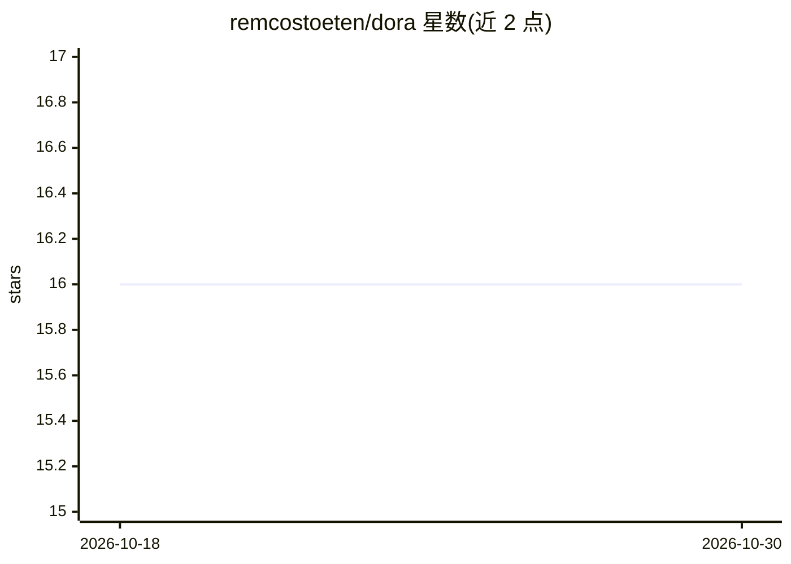

# remcostoeten/dora

⭐ 16 · TypeScript · NOASSERTION · 推送 2026-10-18 · [GitHub](https://github.com/remcostoeten/dora) · [官网](https://doradb.app) · 个人维护

**Rust/Tauri 桌面数据库工作台，支持多种数据库与 AI SQL 生成**

面向开发者的本地数据库客户端：直连 PostgreSQL、MySQL、MariaDB、CockroachDB、SQLite、libSQL/Turso、Cloudflare D1、DuckDB 及 CSV/JSON/Parquet 文件，提供行内编辑（含 dry-run 暂存模式）、多标签 SQL 控制台、Drizzle/Prisma 查询编写与 schema 差异迁移生成。支持 Supabase、Neon、Turso 等账号 OAuth 登录替代连接字符串。AI 功能为基于 schema 的 SQL 生成（⌘I），可选 OpenAI/Anthropic/Gemini/Groq 或完全离线的 Ollama；未添加 API key 时 AI 功能不启用。安装包为 tens of megabytes 级别，GPLv3，无付费版。

## 筛选速览

| 维度 | 判定 | 备注 |
|---|---|---|
| AI 角色 | `ai-enhanced` | 去掉 AI 部分产品仍成立 |
| 许可风险 | `none` | NOASSERTION |
| 部署形态 | `desktop` | 安装包/桌面程序 |
| 模型依赖 | local-ok | 支持本地模型 |
| 硬件要求 | — | 无带数字的原话,不猜 |
| 安装摩擦 | `low` | 无编译、无系统依赖或容器化 |
| 成熟度 | — | 结构信号不足 |

## 能力要点

- 8 种数据库引擎统一浏览/编辑/查询/导出流程
- schema 感知 AI SQL 生成，支持 Ollama 完全离线运行
- Drizzle/Prisma 原生查询编写与 schema 差异迁移生成
- DuckDB 会话查询 CSV/JSON/Parquet 并可跨文件 join

## 适用场景

- 在桌面端直接浏览、编辑和查询多种数据库
- 不写连接字符串，通过账号登录连接托管数据库
- 用自然语言生成基于 schema 的 SQL 查询

## 场景标签

`数据分析` · 领域:效率与自动化

## 证据(README 行号)

> L7:  A native database workbench for PostgreSQL, MySQL, MariaDB, CockroachDB,
> L33: - **Schema-grounded AI SQL** on `⌘I` / `Ctrl+I`, through OpenAI, Anthropic, Gemini, Groq, or a fully offline Ollama

## 星数曲线

2026-10-18 16 → 2026-10-30 16（+0）

---
*卡片 v1 · prompt 1.4 · 生成 2026-10-30 · 置信度 high · 依据 README sha `566f125129d0` · [字段定义](../../DATASET.md)*
