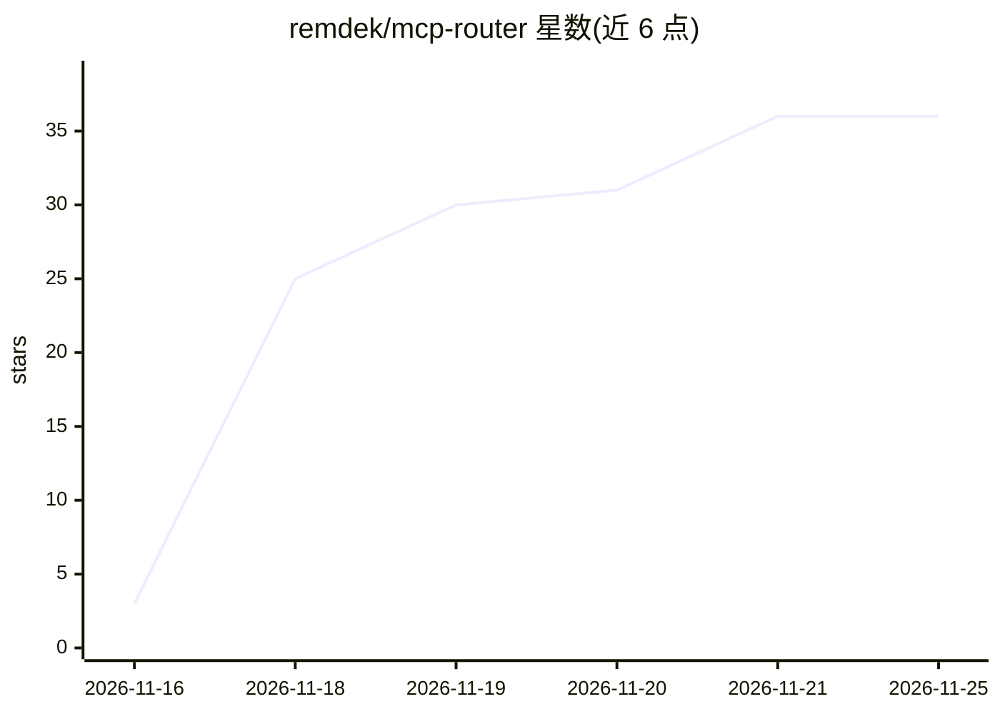

# remdek/mcp-router

⭐ 36 · Python · 推送 2026-11-12 · [GitHub](https://github.com/remdek/mcp-router) · 个人维护

**MCP 服务器路由代理：工具混合搜索与懒加载调用**

面向运行多个 MCP 服务器的团队与 Agent 开发者的 HTTP 代理：将下游 MCP 服务器（stdio/HTTP/SSE/WebSocket）注册到单一 URL，工具索引进 SQLite，通过 search_tools、call_server_tool 等少量元工具暴露给 MCP 客户端，客户端无需逐个配置本地 MCP。搜索采用 BM25 + 向量混合检索，凭据保留在路由主机。技术栈为 FastAPI + SQLite（FTS5/sqlite-vec），支持 Docker Compose 部署、注册表热重载、严格白名单面 /mcp/v2 与本地 review/feedback 审计。

## 筛选速览

| 维度 | 判定 | 备注 |
|---|---|---|
| AI 角色 | `ai-ecosystem` | LLM/agent 周边工具 |
| 许可风险 | `none` | — |
| 部署形态 | `self-host` | docker 或自建部署 |
| 模型依赖 | — | README 未给出锁定关系 |
| 硬件要求 | — | 无带数字的原话,不猜 |
| 安装摩擦 | `low` | 无编译、无系统依赖或容器化 |
| 成熟度 | — | 结构信号不足 |

## 能力要点

- 单一 URL 聚合多个下游 MCP 服务器（stdio/HTTP/SSE/WebSocket）
- SQLite 索引上的 BM25 + 向量混合搜索与按需取 schema
- 严格面 /mcp/v2 支持白名单与只读工具过滤，结果超限截断落盘
- CLI 含 token 税估算（mcp-router tax），可选用 Anthropic count_tokens 精确计数

## 适用场景

- 在共享主机上统一管理多个 MCP 服务器，客户端只配一个 URL
- Agent 需要大量工具但不想在每个客户端配置里粘贴服务器与密钥
- 对不可信客户端只暴露经筛选的工具子集

## 场景标签

`Agent 框架` · 领域:Agent 开发

## 证据(README 行号)

> L7: MCP proxy with lazy tool loading and hybrid search. Clients connect by URL only — no local MCP install on the agent 
> L21: - exposes a small router surface (`search_tools`, `call_server_tool`, …) so agents find and call tools without load

## 星数曲线

2026-11-16 3 → 2026-11-25 36（+33）

---
*卡片 v1 · prompt 1.4 · 生成 2026-11-18 · 置信度 high · 依据 README sha `4cb03574c677` · [字段定义](../../DATASET.md)*
