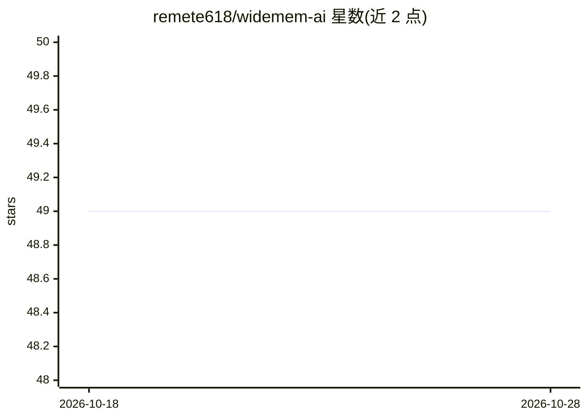

# remete618/widemem-ai

⭐ 48 · Python · Apache-2.0 · 推送 2026-10-24 · [GitHub](https://github.com/remete618/widemem-ai) · [官网](https://widemem.ai) · 个人维护

**本地优先的 LLM 应用/agent 记忆层：抽取事实并管理长期记忆**

面向开发者的 Python 库，为 LLM 应用和 agent 提供长期记忆层：从对话中抽取事实，按重要性（LLM 打分 1-10）与新旧程度加权检索，用单次 LLM 调用批量解决矛盾（ADD/UPDATE/DELETE），检索返回 HIGH/LOW 等置信度。默认全本地运行：Ollama 做 LLM、sentence-transformers 做嵌入、FAISS 与 SQLite 做存储，OpenAI/Anthropic 为可选。另提供 MCP server、LangChain Retriever 与 REST server 集成。YMYL 保护为启发式，非高可用保障。

## 筛选速览

| 维度 | 判定 | 备注 |
|---|---|---|
| AI 角色 | `ai-ecosystem` | LLM/agent 周边工具 |
| 许可风险 | `permissive` | Apache-2.0 |
| 部署形态 | `library` | 以包/库形式分发 |
| 模型依赖 | local-ok | 支持本地模型 |
| 硬件要求 | — | 无带数字的原话,不猜 |
| 安装摩擦 | `medium` | 含编译或系统依赖之一 |
| 成熟度 | — | 结构信号不足 |

## 能力要点

- 重要性打分与衰减加权检索，支持 fast/balanced/deep 三种模式
- 单次 LLM 调用批量解决事实矛盾
- 检索返回四级置信度，支持 '我不知道' 场景
- 默认 Ollama + sentence-transformers + FAISS 全本地栈，云厂商可选

## 适用场景

- 为 agent 添加跨会话的长期记忆
- 本地离线运行的记忆层，数据不出本机
- 通过 MCP 接入 Claude Desktop / Cursor 等客户端
- 健康/财务等关键事实启用重要性下限与强制矛盾检查

## 场景标签

`Agent 记忆` · 领域:Agent 开发

## 证据(README 行号)

> L12: widemem is a local-first memory layer for LLM apps. It extracts facts from conversations, ranks them by importance 
> L120: widemem is developer infrastructure, provided under Apache 2.0 as is. It is not medical, legal, tax or financial a

## 星数曲线

2026-10-18 49 → 2026-10-28 49（+0）

---
*卡片 v1 · prompt 1.4 · 生成 2026-10-24 · 置信度 high · 依据 README sha `b794ab1a3d59` · [字段定义](../../DATASET.md)*
