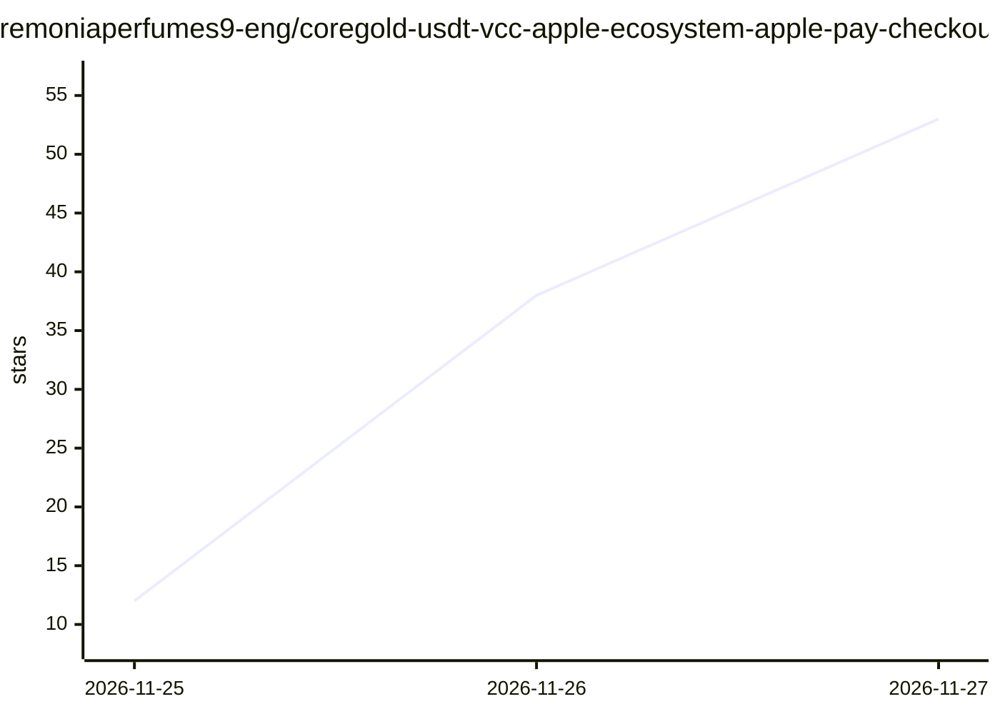

# remoniaperfumes9-eng/coregold-usdt-vcc-apple-ecosystem-apple-pay-checkout

⭐ 53 · 推送 2026-11-23 · [GitHub](https://github.com/remoniaperfumes9-eng/coregold-usdt-vcc-apple-ecosystem-apple-pay-checkout) · [官网](https://app.coregold.io/signup?invite_code=ADvlj9b) · 个人维护 · 中文 README

**面向 Apple 用户的教程：USDT 开虚拟卡绑定 Apple Pay 付费**

一份操作指南文档，面向 iOS/Mac 用户，介绍通过 CoreGold 平台用 USDT（TRC20）充值、开立美国发行卡段 BIN 的虚拟卡，并将卡片绑定到 Apple Wallet/Apple Pay 的完整流程。内容覆盖注册、充值、选择卡计划与账单地址、获取邮件验证 OTP、绑定 Apple Pay 及 Apple ID 账单信息一致性等步骤，目的是在 iOS AI 应用订阅、App Store 购买和 Safari 结账时使用 Face ID 支付。README 含推广邀请链接。

## 筛选速览

| 维度 | 判定 | 备注 |
|---|---|---|
| AI 角色 | `ai-knowledge` | 知识聚合/清单类 |
| 许可风险 | `none` | — |
| 部署形态 | `None` |  |
| 模型依赖 | — | README 未给出锁定关系 |
| 硬件要求 | — | 无带数字的原话,不猜 |
| 安装摩擦 | `low` | 无编译、无系统依赖或容器化 |
| 成熟度 | — | 结构信号不足 |

## 能力要点

- CoreGold 卡 BIN 声明支持绑定 Apple Pay 与 Google Pay
- 卡详情页内直接显示数字钱包验证码（OTP）
- 支持 USDT（TRC20）充值开卡
- 提供从注册到绑卡的四步操作流程

## 适用场景

- 在 iOS 上订阅 ChatGPT、Claude 等 AI 应用时用 Apple Pay 付款
- 为 App Store 购买准备美国发行的虚拟卡
- 将 USDT 兑换为可绑入 Apple Wallet 的虚拟卡

## 场景标签

`教程课程` · 领域:学习与行业

## 证据(README 行号)

> L2: Practical guide for Apple ecosystem users on turning USDT into a US-issued virtual card inside Apple Wallet for smoo
> L7: For iPhone and Mac users, subscribing to AI tools (such as ChatGPT, Claude, or Grok on iOS) or purchasing App Store 

## 星数曲线

2026-11-25 12 → 2026-11-27 53（+41）

---
*卡片 v1 · prompt 1.4 · 生成 2026-11-24 · 置信度 high · 依据 README sha `d8a229e7014d` · [字段定义](../../DATASET.md)*
