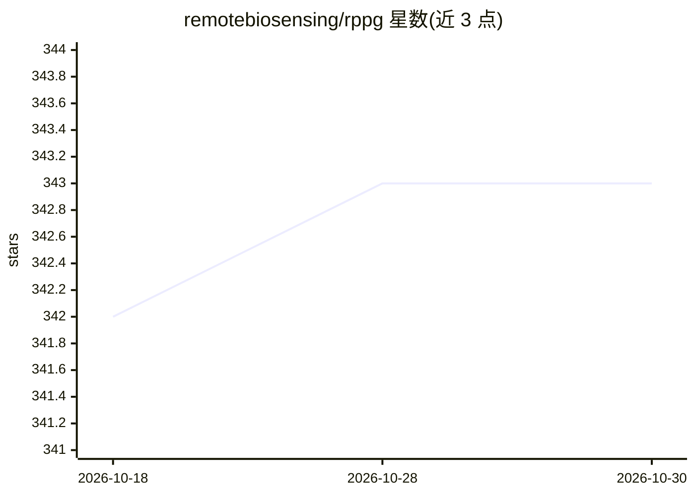

# remotebiosensing/rppg

⭐ 343 · Python · Apache-2.0 · 推送 2025-12-09 · [GitHub](https://github.com/remotebiosensing/rppg) · 组织维护

**面向科研的 rPPG/无创血压模型评测基准框架**

基于 PyTorch 的开源框架，用于实现、评估与基准测试远程光电容积描记（rPPG）与连续无创血压（CNIBP）的 DNN 模型。收录 DeepPhys、PhysNet、BigSmall 等深度模型及 GREEN、CHROM、POS 等传统方法（部分已实现，部分待实现），整理 25 个 rPPG 数据集的获取信息，并给出跨数据集（PURE/UBFC）的 MAE/RMSE/Pearson 性能对比表。提供 conda 环境文件与 Docker 构建方式，配套 arXiv 论文。

## 筛选速览

| 维度 | 判定 | 备注 |
|---|---|---|
| AI 角色 | `ai-ecosystem` | LLM/agent 周边工具 |
| 许可风险 | `permissive` | Apache-2.0 |
| 部署形态 | `self-host` | docker 或自建部署 |
| 模型依赖 | — | README 未给出锁定关系 |
| 硬件要求 | — | 无带数字的原话,不猜 |
| 安装摩擦 | `low` | 无编译、无系统依赖或容器化 |
| 成熟度 | — | 结构信号不足 |

## 能力要点

- 汇集深度与传统两类 rPPG 方法并标注实现状态
- 整理 25 个 rPPG 数据集的元信息与申请/下载链接
- 提供跨数据集（PURE↔UBFC）性能对比表
- 基于 PyTorch，附 arXiv 论文

## 适用场景

- 在统一框架下对比不同 rPPG 模型的跨数据集表现
- 查找与申请 rPPG/CNIBP 研究数据集
- 复现论文中的心率估计指标结果

## 场景标签

`模型评测` `科研工具` · 领域:评测与运维

## 证据(README 行号)

> L9: Remote Biosensing (`rPPG`) is an open-source framework for remote photoplethysmography (rPPG) and non-invasive blood
> L10: We aim to implement, evaluate, and benchmark DNN models for remote photoplethysmography (rPPG) and continuous non-i

## 星数曲线

2026-10-18 342 → 2026-10-30 343（+1）

---
*卡片 v1 · prompt 1.4 · 生成 2026-10-21 · 置信度 high · 依据 README sha `8820e4f04b40` · [字段定义](../../DATASET.md)*
