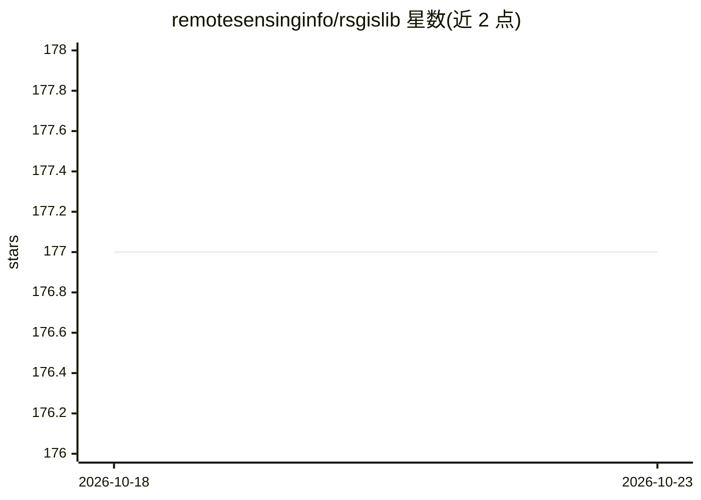

# remotesensinginfo/rsgislib

⭐ 177 · C++ · GPL-3.0 · 推送 2026-06-18 · [GitHub](https://github.com/remotesensinginfo/rsgislib) · [官网](http://www.rsgislib.org) · 组织维护

**遥感与 GIS 空间数据处理的 Python 工具库**

RSGISLib 是一套处理遥感与 GIS 数据集的 Python 模块工具集合，覆盖空间数据分析与处理，主题标签含分类与机器学习。通过 conda-forge 渠道安装，作者另给出包含 GDAL、scikit-learn、geopandas 等在内的推荐基础环境清单与 pip 补充包列表；亦可用 cmake 从源码构建。文档与支持经由项目网站 rsgislib.org 与 Google Group 邮件列表提供，发表成果需引用 2014 年 Computers & Geosciences 论文。

## 筛选速览

| 维度 | 判定 | 备注 |
|---|---|---|
| AI 角色 | `ai-enhanced` | 去掉 AI 部分产品仍成立 |
| 许可风险 | `viral` | GPL-3.0 |
| 部署形态 | `library` | 以包/库形式分发 |
| 模型依赖 | — | README 未给出锁定关系 |
| 硬件要求 | — | 无带数字的原话,不猜 |
| 安装摩擦 | `high` | 编译与系统依赖俱全 |
| 成熟度 | — | 结构信号不足 |

## 能力要点

- 处理遥感与 GIS 数据集的工具集合，以 Python 模块形式提供
- conda-forge 渠道安装，附推荐基础环境清单
- 支持 cmake 从源码构建
- 有 DOI 论文引用要求与邮件列表支持渠道

## 适用场景

- 处理遥感影像与 GIS 空间数据
- 构建包含机器学习工具的遥感分析环境
- 科研工作中按论文要求引用使用

## 场景标签

 · 领域:地球观测/空间数据处理

## 证据(README 行号)

> L11: The Remote Sensing and GIS software library (RSGISLib) is a collection of tools for processing remote sensing and G
> L30: conda install -c conda-forge rsgislib gdal libgdal-arrow-parquet libgdal-fits libgdal-grib libgdal-hdf4 libgdal-hdf

## 星数曲线

2026-10-18 177 → 2026-10-23 177（+0）

---
*卡片 v1 · prompt 1.4 · 生成 2026-10-22 · 置信度 mid · 依据 README sha `1ae8f61c4216` · [字段定义](../../DATASET.md)*
