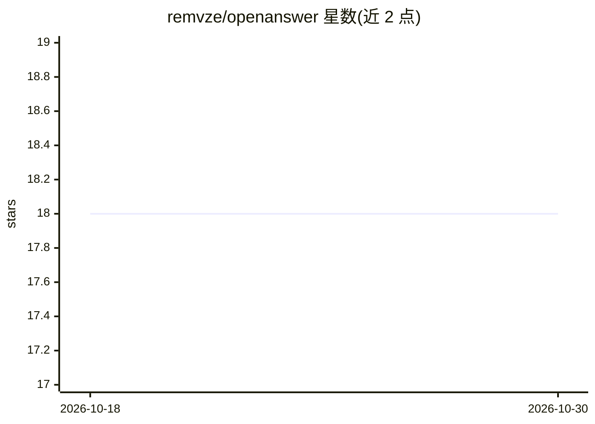

# remvze/openanswer

⭐ 18 · TypeScript · MIT · 推送 2026-09-15 · [GitHub](https://github.com/remvze/openanswer) · [官网](https://npmjs.com/package/nlc) · 个人维护

**终端里向 AI 提问并执行命令的小型 CLI 工具**

基于 Node.js 20+ 的命令行 AI 工具，使用 OpenAI API key，通过 answer 命令提问，输出纯文本以便与其他命令行工具组合。支持管道输入（如将日志或文本喂给模型总结/分析）、多轮对话模式（chat）、以及经确认后代为执行 shell 命令（run，默认需确认，--yes 跳过）。工具会向模型报告操作系统、架构、shell、工作目录与 Node 版本，并用检测到的 shell 执行命令。通过 npm 全局安装，配置经 answer config 管理。

## 筛选速览

| 维度 | 判定 | 备注 |
|---|---|---|
| AI 角色 | `ai-native` | 本体是模型或模型工具 |
| 许可风险 | `permissive` | MIT |
| 部署形态 | `library` | 以包/库形式分发 |
| 模型依赖 | — | README 未给出锁定关系 |
| 硬件要求 | — | 无带数字的原话,不猜 |
| 安装摩擦 | `low` | 无编译、无系统依赖或容器化 |
| 成熟度 | — | 结构信号不足 |

## 能力要点

- 纯文本输出，可与其他命令行工具管道组合
- 多轮对话模式（answer chat）
- answer run 经确认后代为执行 shell 命令
- 向模型传递系统环境信息并以检测到的 shell 执行

## 适用场景

- 在终端快速向 AI 提问获取答案
- 把日志或文件通过管道交给 AI 总结或分析错误
- 让 AI 代为执行系统检查命令

## 场景标签

`AI 助手` · 领域:对话与助手

## 证据(README 行号)

> L3: OpenAnswer is a small AI utility for asking questions from the terminal. Its output is plain text, so it composes na
> L7: - Node.js 20+
> L8: - An OpenAI API key

## 星数曲线

2026-10-18 18 → 2026-10-30 18（+0）

---
*卡片 v1 · prompt 1.4 · 生成 2026-10-29 · 置信度 high · 依据 README sha `02b9dc78a690` · [字段定义](../../DATASET.md)*
