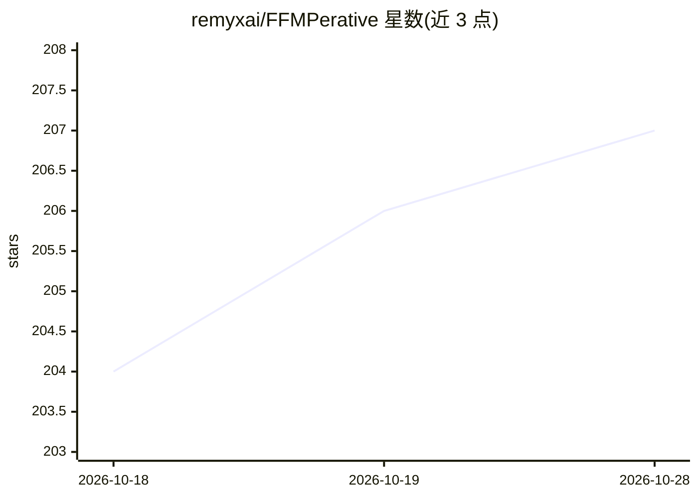

# remyxai/FFMPerative

⭐ 207 · Python · MIT · 推送 2026-06-07 · [GitHub](https://github.com/remyxai/FFMPerative) · [官网](https://remyx.ai) · 组织维护

**用自然语言对话生成 ffmpeg 命令的视频编辑工具**

FFMPerative 是一个通过 LLM 驱动的聊天界面进行视频编辑的 Python 库与 CLI：用户以自然语言描述编辑意图，工具生成并执行对应 ffmpeg 操作，支持变速、缩放、裁剪、翻转、倒放视频/GIF、语音转文字转录与字幕合并等。提供 Python API（ffmp 函数）与命令行（do/compose 子命令），compose 可将多段剪辑按文本提示合成视频。运行需 Python 3 与系统安装 ffmpeg，可通过 pip 安装或从源码安装。

## 筛选速览

| 维度 | 判定 | 备注 |
|---|---|---|
| AI 角色 | `ai-native` | 本体是模型或模型工具 |
| 许可风险 | `permissive` | MIT |
| 部署形态 | `library` | 以包/库形式分发 |
| 模型依赖 | — | README 未给出锁定关系 |
| 硬件要求 | — | 无带数字的原话,不猜 |
| 安装摩擦 | `medium` | 含编译或系统依赖之一 |
| 成熟度 | — | 结构信号不足 |

## 能力要点

- 自然语言描述编辑意图，生成并执行 ffmpeg 操作
- 支持变速/裁剪/翻转/倒放与字幕合并、语音转文字
- 提供 Python API 与 CLI（do/compose 子命令）
- 提供 FFMPerative 数据集与 LLaMA2 checkpoint 资源

## 适用场景

- 不会写 ffmpeg 命令的用户用自然语言完成视频编辑
- 批量剪辑片段并按文本提示合成视频
- 为视频添加字幕与语音转文字转录

## 场景标签

`图像视频处理` `语音识别` · 领域:感知与多模态

## 证据(README 行号)

> L3: FFMPerative is your copilot for video editing workflows. Powered by Large Language Models (LLMs) through an intuitiv
> L6: * Speech-to-Text Transcription and Closed-Captions

## 星数曲线

2026-10-18 204 → 2026-10-28 207（+3）

---
*卡片 v1 · prompt 1.4 · 生成 2026-10-22 · 置信度 high · 依据 README sha `63d7ca6ea746` · [字段定义](../../DATASET.md)*
