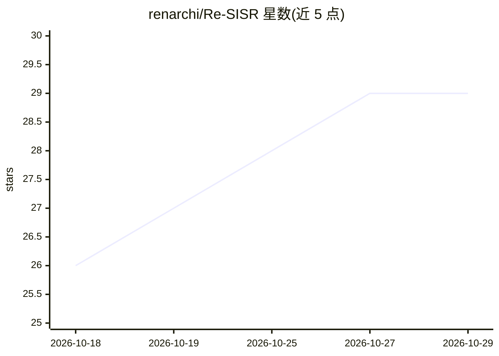

# renarchi/Re-SISR

⭐ 29 · JavaScript · NOASSERTION · 推送 2026-10-06 · [GitHub](https://github.com/renarchi/Re-SISR) · [官网](https://renarchi.github.io/Re-SISR/) · 个人维护

**自训练的超分辨率模型集合：动漫与通用图像放大**

renarchi 训练并发布的一系列单图像超分辨率（SISR）模型权重，含 marina（988 参数 GLSL shader、2×、WIP）、Adore（2× ONNX，实时动漫放大，Fallin 后继）、Fallin（2× ONNX，Soft/Strong 变体，旧版）、Alchemy（4× PTH，通用放大与压缩伪影去除）。每个 release 附模型权重、变体与说明。许可分层：Adore 及之后为 CC BY-NC-SA 4.0，更早版本为 CC BY 4.0，商业例外见专文。面向使用放大模型的图像处理用户。

## 筛选速览

| 维度 | 判定 | 备注 |
|---|---|---|
| AI 角色 | `ai-native` | 本体是模型或模型工具 |
| 许可风险 | `none` | NOASSERTION |
| 部署形态 | `None` |  |
| 模型依赖 | — | README 未给出锁定关系 |
| 硬件要求 | — | 无带数字的原话,不猜 |
| 安装摩擦 | `low` | 无编译、无系统依赖或容器化 |
| 成熟度 | `idea` | |

## 能力要点

- 4 个模型覆盖动漫实时放大与通用 4× 放大
- marina 为 988 参数的 GLSL shader，支持实时放大
- 提供 ONNX、GLSL、PTH 多种模型格式
- 许可分层：新旧版本分别采用 CC BY-NC-SA 4.0 与 CC BY 4.0

## 适用场景

- 下载预训练权重做动漫图像实时放大
- 用 Alchemy 做通用图像 4× 放大与压缩伪影去除
- 查看各模型的变体与使用说明

## 场景标签

`图像视频处理` · 领域:感知与多模态

## 证据(README 行号)

> L7: Super-resolution models trained by renarchi.
> L15: |marina (WIP)|2×|ONNX/GLSL|A 988-parameter shader for real-time anime upscaling with an Adore-like look.|

## 星数曲线

2026-10-18 26 → 2026-10-29 29（+3）

---
*卡片 v1 · prompt 1.4 · 生成 2026-10-26 · 置信度 high · 依据 README sha `c2b5f9edf477` · [字段定义](../../DATASET.md)*
