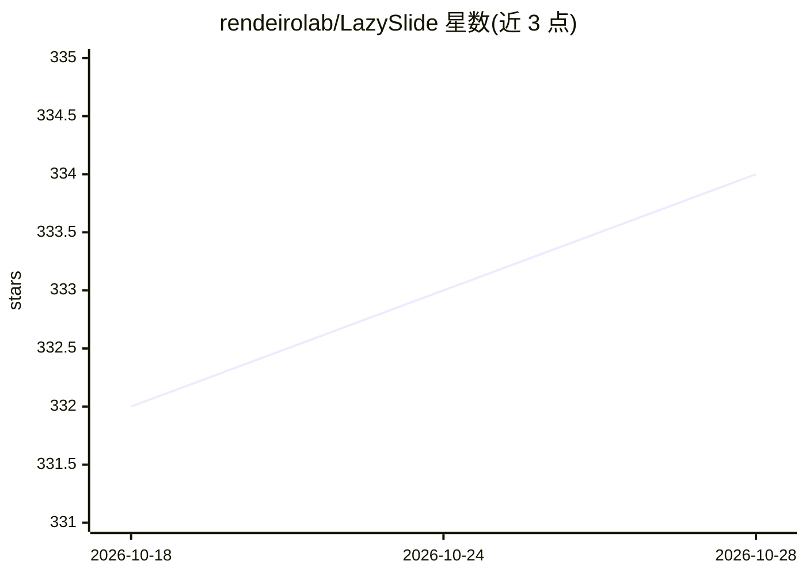

# rendeirolab/LazySlide

⭐ 334 · Python · MIT · 推送 2026-10-06 · [GitHub](https://github.com/rendeirolab/LazySlide) · [官网](https://lazyslide.rtfd.io/) · 组织维护

**数字病理全切片图像分析 Python 框架**

面向数字与计算病理学研究者，提供从原始全切片图像（WSI）到组织掩膜、切片瓦片、基础模型特征提取、细胞分割与零样本预测的端到端 Python 框架。支持 30+ 病理基础模型（UNI、Virchow、Prov-GigaPath 等）与视觉-语言模型零样本分类；结果以 SpatialData 存储，可直接接入 scanpy、anndata、squidpy 等 scverse 工具。支持 SVS、NDPI、MRXS、DICOM、CZI 等多种切片格式，并基于 PyTorch 支持训练自定义模型。Python 3.11–3.14，跨平台 pip/conda 安装，MIT 许可，发表于 Nature Methods。

## 筛选速览

| 维度 | 判定 | 备注 |
|---|---|---|
| AI 角色 | `ai-native` | 本体是模型或模型工具 |
| 许可风险 | `permissive` | MIT |
| 部署形态 | `library` | 以包/库形式分发 |
| 模型依赖 | — | README 未给出锁定关系 |
| 硬件要求 | — | 无带数字的原话,不猜 |
| 安装摩擦 | `low` | 无编译、无系统依赖或容器化 |
| 成熟度 | — | 结构信号不足 |

## 能力要点

- 30+ 病理基础模型瓦片特征提取，或任意 timm 模型
- 细胞分割（InstanSeg、Cellpose）与组织/伪影分割
- 视觉-语言模型零样本分类、切片描述与文本检索
- 结果存储为 SpatialData，接入 scanpy/anndata/squidpy

## 适用场景

- 对病理切片做组织检测、瓦片与特征提取
- 用基础模型做零样本分类或细胞分割
- 将病理形态学与基因表达数据联合分析

## 场景标签

`目标检测` `科研工具` · 领域:学习与行业

## 证据(README 行号)

> L19: LazySlide is a Python framework for whole slide image (WSI) analysis in digital and computational pathology. From a
> L24: - **Pathology foundation models**: tile features from 30+ models (UNI, Virchow, Prov-GigaPath, H-optimus, …) or any
> L26: - **Vision-language models**: zero-shot classification and segmentation, slide captioning, text search (CONCH, PLIP

## 星数曲线

2026-10-18 332 → 2026-10-28 334（+2）

---
*卡片 v1 · prompt 1.4 · 生成 2026-10-21 · 置信度 high · 依据 README sha `2ba8d7acb794` · [字段定义](../../DATASET.md)*
