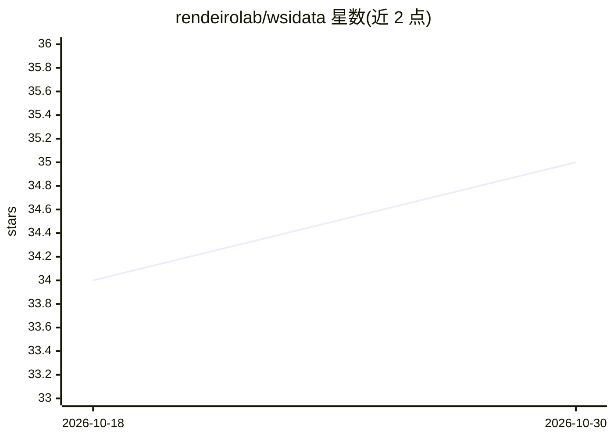

# rendeirolab/wsidata

⭐ 35 · Python · MIT · 推送 2026-10-01 · [GitHub](https://github.com/rendeirolab/wsidata) · [官网](https://wsidata.rtfd.io/) · 组织维护

**全切片病理图像分析的高效数据结构与 IO 库**

wsidata 为全切片图像（WSI）分析提供高效数据结构与输入输出功能，与 LazySlide 配合完成病理切片分析流程。项目属于 scverse 生态系统，发表于 Nature Methods，通过 pip 与 conda-forge 双渠道发布。README 仅含安装说明与徽章信息，具体数据结构实现细节与支持格式需查阅文档与教程。

## 筛选速览

| 维度 | 判定 | 备注 |
|---|---|---|
| AI 角色 | `ai-ecosystem` | LLM/agent 周边工具 |
| 许可风险 | `permissive` | MIT |
| 部署形态 | `library` | 以包/库形式分发 |
| 模型依赖 | — | README 未给出锁定关系 |
| 硬件要求 | — | 无带数字的原话,不猜 |
| 安装摩擦 | `low` | 无编译、无系统依赖或容器化 |
| 成熟度 | — | 结构信号不足 |

## 能力要点

- 为 WSI 分析提供高效数据结构与 IO
- 与 LazySlide 协同设计
- pip 与 conda-forge 双渠道发布

## 适用场景

- 数字病理分析项目读取与管理全切片图像
- 配合 LazySlide 构建组织切片分析流程

## 场景标签

 · 领域:数字病理/生物图像分析

## 证据(README 行号)

> L3:  Efficient data structures and IO for whole slide image analysis
> L16: wsidata is designed to work with LazySlide

## 星数曲线

2026-10-18 34 → 2026-10-30 35（+1）

---
*卡片 v1 · prompt 1.4 · 生成 2026-10-25 · 置信度 mid · 依据 README sha `ba2876725f0c` · [字段定义](../../DATASET.md)*
