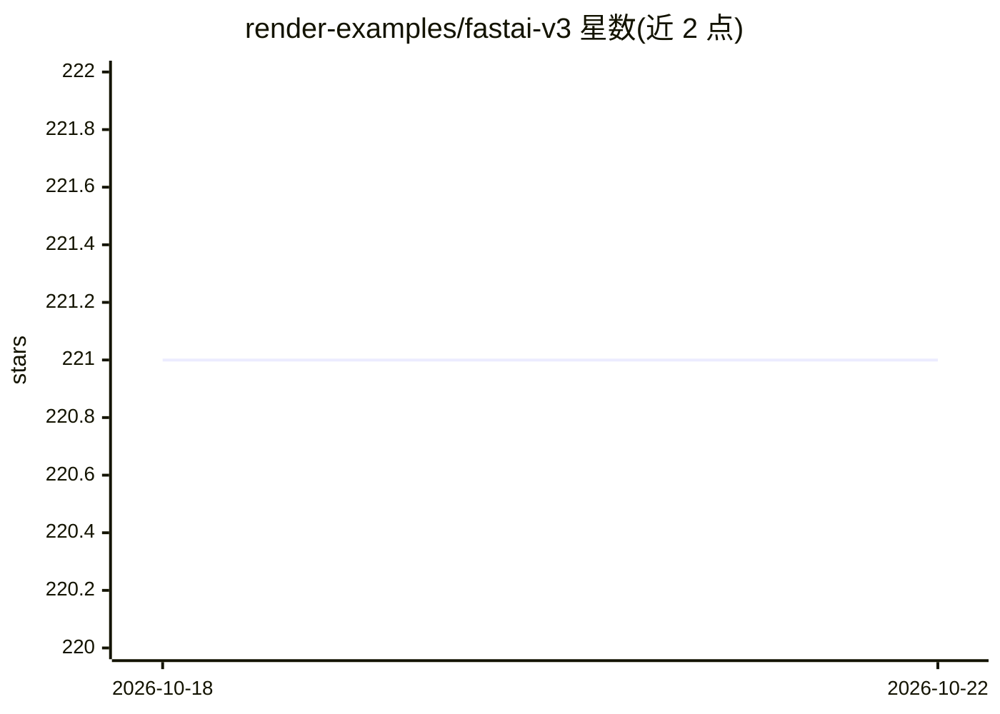

# render-examples/fastai-v3

⭐ 221 · Python · 推送 2026-02-18 · [GitHub](https://github.com/render-examples/fastai-v3) · [官网](https://render.com) · 组织维护

**在 Render 上部署 fast.ai 模型的起始模板应用**

基于 fast.ai v3 的模型部署示例仓库：提供可直接改造的 starter 应用结构，用于将 fast.ai 训练的图像分类模型部署到 Render 平台，示例为熊类图片分类。支持通过 Docker 在本地构建和运行进行测试，生产部署遵循 fast.ai 官方 Render 部署指南，线上示例应用运行在 onrender.com。面向使用 fast.ai 课程并希望上线模型的学习者与开发者。

## 筛选速览

| 维度 | 判定 | 备注 |
|---|---|---|
| AI 角色 | `ai-ecosystem` | LLM/agent 周边工具 |
| 许可风险 | `none` | — |
| 部署形态 | `self-host` | docker 或自建部署 |
| 模型依赖 | — | README 未给出锁定关系 |
| 硬件要求 | — | 无带数字的原话,不猜 |
| 安装摩擦 | `low` | 无编译、无系统依赖或容器化 |
| 成熟度 | — | 结构信号不足 |

## 能力要点

- 提供 fast.ai 模型部署到 Render 的起始代码
- Docker 本地构建与运行命令（端口 5000）
- 附带在线示例应用与生产部署指南链接

## 适用场景

- 把 fast.ai 训练的模型部署到 Render 平台
- 参考模板搭建自己的模型推理 Web 服务

## 场景标签

`推理引擎` · 领域:训练与推理

## 证据(README 行号)

> L1: # Starter for deploying fast.ai models on Render
> L3: This repo can be used as a starting point to deploy fast.ai models on Render.

## 星数曲线

2026-10-18 221 → 2026-10-22 221（+0）

---
*卡片 v1 · prompt 1.4 · 生成 2026-10-22 · 置信度 mid · 依据 README sha `2fb68c4ebd32` · [字段定义](../../DATASET.md)*
