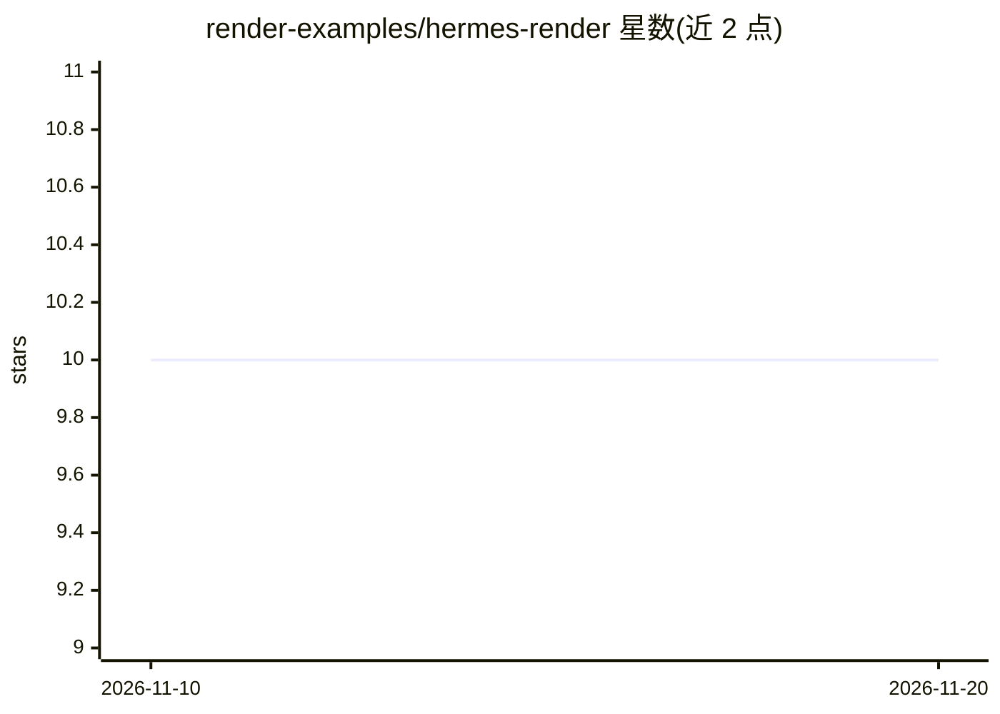

# render-examples/hermes-render

⭐ 10 · MIT · 推送 2026-05-27 · [GitHub](https://github.com/render-examples/hermes-render) · 组织维护

**一键在 Render 上部署 Hermes Agent 的 Docker 模板**

一个 Render Blueprint 模板仓库：以单个 Docker web service 部署 Nous Research 的 Hermes Agent，并在上游容器之上预置 Render MCP server（提供 list_services/get_metrics/list_logs 等工具）与 22 个 Render skills，以及一个说明覆盖层 skill。状态（API keys、配置、会话库、记忆等）存放在持久磁盘上以保证升级不破坏数据；通过浏览器 dashboard 或 Render Shell/SSH CLI 配置与对话。需 Render standard 及以上套餐，dashboard 本身无内置认证，需自行加防护。

## 筛选速览

| 维度 | 判定 | 备注 |
|---|---|---|
| AI 角色 | `ai-ecosystem` | LLM/agent 周边工具 |
| 许可风险 | `permissive` | MIT |
| 部署形态 | `desktop` | 安装包/桌面程序 |
| 模型依赖 | — | README 未给出锁定关系 |
| 硬件要求 | — | 无带数字的原话,不猜 |
| 安装摩擦 | `low` | 无编译、无系统依赖或容器化 |
| 成熟度 | — | 结构信号不足 |

## 能力要点

- 启动时幂等注册 Render MCP server，提供 mcp_render_* 工具集
- 预置 render-oss/skills 22 个 Render 技能并锁定 commit
- 持久磁盘保存 .env、config.yaml、会话与记忆，重部署不丢失
- dashboard 浏览器端 TUI 与 CLI 两种交互路径

## 适用场景

- 在 Render 上一键自托管 Hermes Agent
- 让 agent 通过 MCP 工具查看和管理自己的 Render 资源
- 通过 Telegram/Discord/Slack 接入 agent 聊天

## 场景标签

`聊天机器人` · 领域:对话与助手

## 证据(README 行号)

> L3: Deploy Hermes Agent (the self-improving AI agent from Nous Research) on Render as a single Docker web service, **alr
> L5: - The Render MCP server registered in `config.yaml` at boot, so MCP tools appear as `mcp_render_list_services`, `mcp
> L55: - **A Render account** with at least the `standard` plan ($25/month at time of writing). The free plan can't run th

## 星数曲线

2026-11-10 10 → 2026-11-20 10（+0）

---
*卡片 v1 · prompt 1.4 · 生成 2026-11-19 · 置信度 high · 依据 README sha `0eb58df80b13` · [字段定义](../../DATASET.md)*
