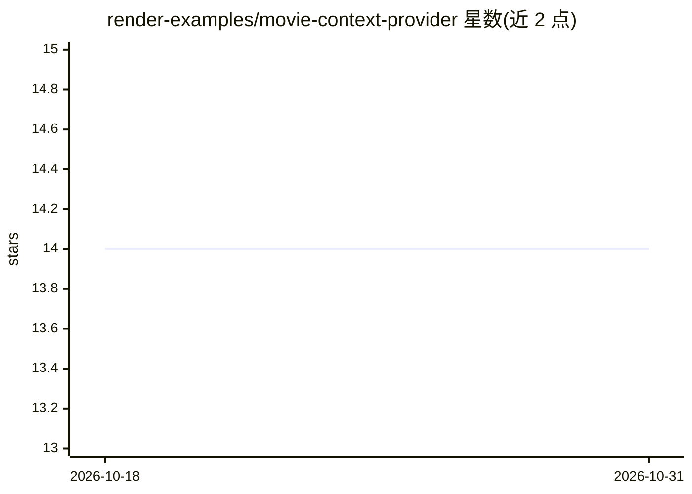

# render-examples/movie-context-provider

⭐ 14 · TypeScript · MIT · 推送 2025-12-17 · [GitHub](https://github.com/render-examples/movie-context-provider) · 组织维护

**给开发者的电影观影单 MCP/OpenAI App 演示：在 ChatGPT 内管观影单并获推荐**

基于 OpenAI Apps SDK 的 TypeScript 演示应用：实现 MCP 工具（电影搜索/发现、观影单与观看历史管理、偏好设置）与 ChatGPT 内渲染的交互式 widget（海报、列表、偏好编辑器）。电影数据来自 TMDB API；仅个性化推荐工具需 LLM API key，支持 OpenAI/Anthropic/Gemini 三家按可用 key 自动选择。数据用 PostgreSQL 持久化，内置 Valkey 缓存。面向希望学习并 fork 自建 MCP 应用的开发者，通过 Render blueprint 零配置部署，也可在 Claude Desktop、Cursor 等 MCP 客户端使用（无 widget）。

## 筛选速览

| 维度 | 判定 | 备注 |
|---|---|---|
| AI 角色 | `ai-enhanced` | 去掉 AI 部分产品仍成立 |
| 许可风险 | `permissive` | MIT |
| 部署形态 | `library` | 以包/库形式分发 |
| 模型依赖 | — | README 未给出锁定关系 |
| 硬件要求 | — | 无带数字的原话,不猜 |
| 安装摩擦 | `low` | 无编译、无系统依赖或容器化 |
| 成熟度 | — | 结构信号不足 |

## 能力要点

- 提供电影搜索、观影单、观看历史、偏好管理等 MCP 工具集
- 在 ChatGPT 内渲染海报、列表、偏好编辑三类交互式 widget
- 推荐工具支持 OpenAI/Anthropic/Gemini 按 API key 自动检测
- render.yaml blueprint 一键部署 PostgreSQL、Valkey 与前后端服务

## 适用场景

- 在 ChatGPT 对话中管理个人电影观影单并获取推荐
- 学习 OpenAI Apps SDK 的 widget 与 MCP 工具开发
- fork 后改造为自己的 MCP 应用并部署到 Render

## 场景标签

 · 领域:应用开发/示例项目

## 证据(README 行号)

> L25: **Fork this repository** to build your own MCP-powered OpenAI App. Customize it, learn from it, and deploy your own
> L57: > **Note:** Only the `get_recommendations` tool requires an LLM API key. All other features work with just the TMDB
> L130: > **\*At least one LLM API key is required** if you want to use the `get_recommendations` tool. All other features

## 星数曲线

2026-10-18 14 → 2026-10-31 14（+0）

---
*卡片 v1 · prompt 1.4 · 生成 2026-10-31 · 置信度 low · 依据 README sha `e1470dc2ee25` · [字段定义](../../DATASET.md)*
