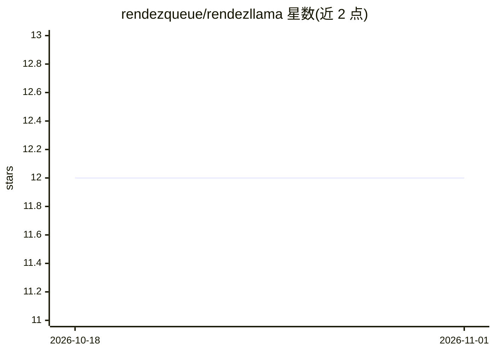

# rendezqueue/rendezllama

⭐ 12 · C++ · ISC · 推送 2026-01-31 · [GitHub](https://github.com/rendezqueue/rendezllama) · 个人维护

**基于 llama.cpp 的本地聊天机器人文本 CLI**

Rendezllama 是一个运行于 llama.cpp 之上的文本界面命令行工具，用于驱动本地聊天机器人：通过 priming prompt 与 rolling prompt 组织对话上下文，提供行内编辑、删除 token/词、重新生成（/r、/R）、按字节数生成（/gets）、角色名切换、采样参数热调整等命令来实时引导与修正生成过程。面向能在本地编译 C++ 并已备好量化权重的用户，构建时经 Make 调用 CMake 生成 bld/ 目录；未来计划提供连接家庭服务器聊天进程的 PWA。

## 筛选速览

| 维度 | 判定 | 备注 |
|---|---|---|
| AI 角色 | `ai-ecosystem` | LLM/agent 周边工具 |
| 许可风险 | `permissive` | ISC |
| 部署形态 | `None` |  |
| 模型依赖 | local-ok | 支持本地模型 |
| 硬件要求 | — | 无带数字的原话,不猜 |
| 安装摩擦 | `medium` | 含编译或系统依赖之一 |
| 成熟度 | `idea` | |

## 能力要点

- rolling prompt + priming prompt 的对话上下文管理，旧对话自动滚出上下文
- 细粒度生成控制：/r 重生成、/gets 按字节上限生成、/b /B 删除 token/词
- 运行中通过命令调整采样参数（如 temperature）
- 支持 LoRA 文件与记忆选项（见 doc 文档）

## 适用场景

- 本地运行量化 LLM 进行长对话并随时修正生成内容
- 通过 priming/rolling 提示文件控制对话风格与角色
- 在家庭服务器跑模型、用 CLI 交互使用

## 场景标签

`聊天机器人` · 领域:对话与助手

## 证据(README 行号)

> L3: Rendezllama is a text interface for running a local chatbot based on ggerganov's llama.cpp.
> L12: MODEL="${MODEL:-../llama.cpp/models/7B/ggml-model-q4_0.gguf}"

## 星数曲线

2026-10-18 12 → 2026-11-01 12（+0）

---
*卡片 v1 · prompt 1.4 · 生成 2026-11-01 · 置信度 high · 依据 README sha `f9fd4c78dbdd` · [字段定义](../../DATASET.md)*
