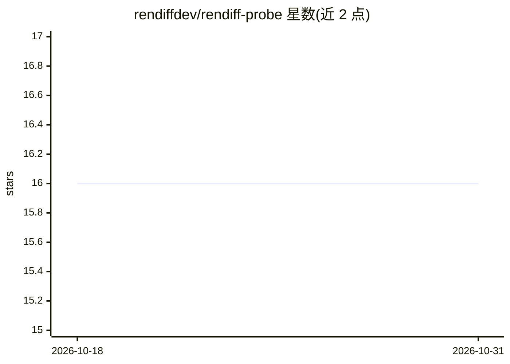

# rendiffdev/rendiff-probe

⭐ 16 · Go · MIT · 推送 2025-12-08 · [GitHub](https://github.com/rendiffdev/rendiff-probe) · 个人维护

**基于 FFprobe 的视频质检 API/CLI，含 LLM 分析报告**

以 FFprobe 为核心引擎的视频/音频文件分析服务，提供 REST API、GraphQL、CLI 三种接口。覆盖 19 个广播级 QC 类别、26 个并行内容分析器与 121 项参数，包括黑场/静帧检测、EBU R128 响度、HDR 分析、MXF/IMF/传输流合规、PSE 闪光检测等。支持 URL/HLS 探测、批处理、WebSocket 进度，内嵌 SQLite 与 Valkey 缓存，可选 Ollama 生成 LLM 分析报告。面向广播/流媒体质量控制的开发者，Docker 部署，CLI 另需 Go 1.24+ 与 FFprobe。

## 筛选速览

| 维度 | 判定 | 备注 |
|---|---|---|
| AI 角色 | `ai-enhanced` | 去掉 AI 部分产品仍成立 |
| 许可风险 | `permissive` | MIT |
| 部署形态 | `self-host` | docker 或自建部署 |
| 模型依赖 | local-ok | 支持本地模型 |
| 硬件要求 | — | 无带数字的原话,不猜 |
| 安装摩擦 | `low` | 无编译、无系统依赖或容器化 |
| 成熟度 | — | 结构信号不足 |

## 能力要点

- 19 个 QC 类别 / 26 个并行内容分析器 / 121 项参数
- REST + GraphQL + CLI 三种接口
- URL 与 HLS 流直接探测、并行批处理
- 可选 Ollama 生成 LLM 专业分析报告

## 适用场景

- 交付前对视频做广播/流媒体合规质检
- 批量分析媒体文件的画质与响度问题
- 流媒体平台自动检测 HDR 与安全合规参数

## 场景标签

`图像视频处理` · 领域:感知与多模态

## 证据(README 行号)

> L5: A production-ready REST API and CLI tool for comprehensive video/audio file analysis, built on top of FFprobe with 1
> L35: - **LLM-Powered Insights**: AI-generated professional analysis reports
> L55: - FFprobe installed (for CLI)

## 星数曲线

2026-10-18 16 → 2026-10-31 16（+0）

---
*卡片 v1 · prompt 1.4 · 生成 2026-10-30 · 置信度 high · 依据 README sha `27ea5cd382ba` · [字段定义](../../DATASET.md)*
